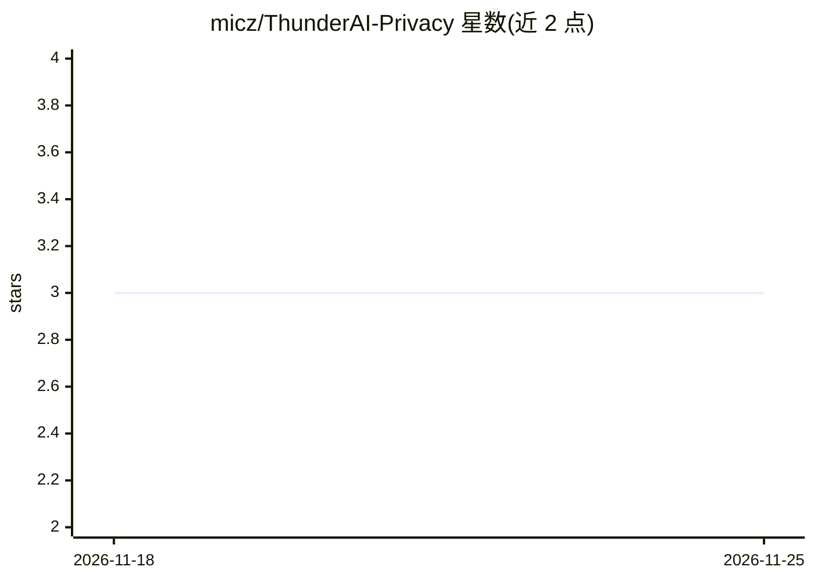

# micz/ThunderAI-Privacy

⭐ 3 · JavaScript · GPL-3.0 · 推送 2026-11-11 · [GitHub](https://github.com/micz/ThunderAI-Privacy) · [官网](https://micz.it/thunderbird-addon-thunderai/#privacy) · 个人维护

**Thunderbird 用户在提示词发给 AI 前本地掩码个人数据的配套扩展**

ThunderAI 的配套 Thunderbird 扩展：在邮件文本进入 AI 提供商前，于本机用 WebGPU 或 CPU/WASM 运行本地模型检测并掩码个人数据（PII），AI 返回后在本地还原；提供商侧对话历史保持掩码态。支持长输入的分块重叠处理、后台模型下载与删除、诊断日志仅记录钩子内容。单独安装无任何作用，必须与 ThunderAI 5.2.0+ 配合，且需 Thunderbird 153+。官方声明检测可能遗漏数据，且仅作用于 API 连接方式。

## 筛选速览

| 维度 | 判定 | 备注 |
|---|---|---|
| AI 角色 | `ai-native` | 本体是模型或模型工具 |
| 许可风险 | `viral` | GPL-3.0 |
| 部署形态 | `None` |  |
| 模型依赖 | — | README 未给出锁定关系 |
| 硬件要求 | — | 无带数字的原话,不猜 |
| 安装摩擦 | `low` | 无编译、无系统依赖或容器化 |
| 成熟度 | — | 结构信号不足 |

## 能力要点

- 本地 WebGPU/WASM 推理检测 PII，邮件文本不上传
- 掩码提示词并在响应中还原，提供商历史保持掩码
- 长输入分块重叠处理，带进度与取消
- 模型锁定固定版本，Hugging Face 下载权限仅用于取模型

## 适用场景

- 用 ThunderAI 处理邮件时防止个人数据发给 AI 提供商
- 企业合规要求 AI 调用前先脱敏邮件内容

## 场景标签

 · 领域:隐私/浏览器与邮件扩展

## 证据(README 行号)

> L11: ThunderAI Privacy is an add-on for Thunderbird, designed to add privacy features to ThunderAI.
> L14: > ThunderAI-Privacy is a companion add-on: it does nothing on its own.
> L19: * Local, best-effort personal-data detection with WebGPU or CPU/WASM.

## 星数曲线

2026-11-18 3 → 2026-11-25 3（+0）

---
*卡片 v1 · prompt 1.4 · 生成 2026-11-22 · 置信度 high · 依据 README sha `3c0b4f51f54d` · [字段定义](../../DATASET.md)*
