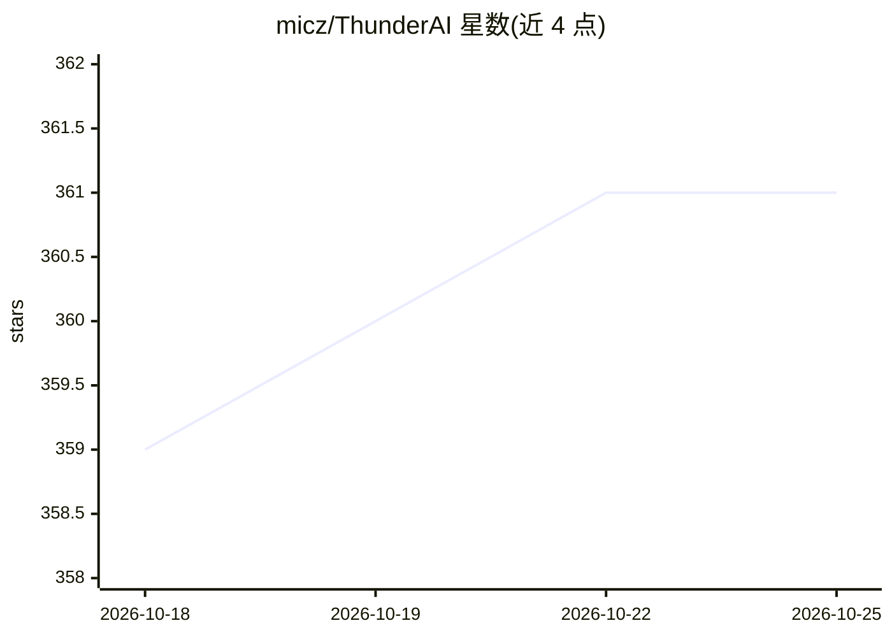

# micz/ThunderAI

⭐ 361 · JavaScript · GPL-3.0 · 推送 2026-10-23 · [GitHub](https://github.com/micz/ThunderAI) · [官网](https://micz.it/thunderbird-addon-thunderai/) · 个人维护 · 中文 README

**让 AI 处理邮件的 Thunderbird 附加组件**

ThunderAI 是一个 Thunderbird 附加组件，在邮箱内调用 AI 完成邮件回复、语法校对、改写、摘要、翻译、打标签、分类，并从邮件提取日历事件或任务（后者需配套插件 ThunderAI Sparks）。可连接 ChatGPT Web、OpenAI API、Google Gemini、Claude API，或经 Ollama、OpenAI 兼容服务器本地运行；支持自定义提示词、占位符、批处理与自动功能（自动打标签、垃圾邮件过滤、自动摘要/翻译）。面向个人与企业用户，支持 Thunderbird 企业策略预配置。要求 Thunderbird 140.0+。

## 筛选速览

| 维度 | 判定 | 备注 |
|---|---|---|
| AI 角色 | `ai-enhanced` | 去掉 AI 部分产品仍成立 |
| 许可风险 | `viral` | GPL-3.0 |
| 部署形态 | `desktop` | 安装包/桌面程序 |
| 模型依赖 | local-ok | 支持本地模型 |
| 硬件要求 | — | 无带数字的原话,不猜 |
| 安装摩擦 | `low` | 无编译、无系统依赖或容器化 |
| 成熟度 | — | 结构信号不足 |

## 能力要点

- 接入 ChatGPT/OpenAI/Gemini/Claude 云端或 Ollama/OpenAI 兼容服务器本地运行
- 邮件回复/校对/翻译/摘要/分类/提取日历事件与任务
- 自动功能：自动打标签、垃圾邮件过滤、自动摘要与自动翻译
- 自定义提示词与数据占位符，逐提示词选择不同 AI 提供商
- 支持 Thunderbird 企业策略（policies.json）集中配置

## 适用场景

- 在 Thunderbird 里让 AI 起草回复、翻译或总结邮件
- 自动给来信打标签并把垃圾邮件移入垃圾箱
- 从邮件提取带提醒的日历事件或任务
- 组织内统一预配置 AI 连接与提示词

## 场景标签

`AI 写作` `工作流自动化` · 领域:效率与自动化

## 证据(README 行号)

> L9: ThunderAI is a Thunderbird add-on that brings AI directly into your mailbox: analyse, write, correct, translate, sum
> L11: You can connect it to a **cloud provider** (ChatGPT, OpenAI, Google Gemini, Claude) or keep everything **local** wi

## 星数曲线

2026-10-18 359 → 2026-10-25 361（+2）

---
*卡片 v1 · prompt 1.4 · 生成 2026-10-21 · 置信度 high · 依据 README sha `cb03c8047b16` · [字段定义](../../DATASET.md)*
