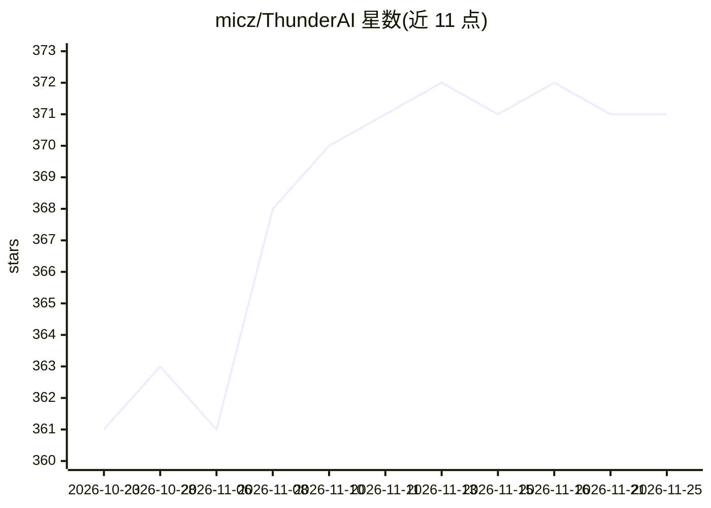

# micz/ThunderAI

⭐ 371 · JavaScript · GPL-3.0 · 推送 2026-11-18 · [GitHub](https://github.com/micz/ThunderAI) · [官网](https://micz.it/thunderbird-addon-thunderai/) · 个人维护 · 中文 README

**Thunderbird 邮件 AI 插件：在邮箱内分析、改写、翻译邮件**

运行在 Thunderbird 140+ 上的插件，将 AI 接入邮箱：提供回复起草、校对（交互式变更逐项接受/拒绝）、改写语气、摘要、翻译、自动打标签、分类，以及从邮件提取日历事件与任务等操作；API 接入模式下可对收件自动执行打标签、垃圾邮件过滤、摘要与翻译。支持 ChatGPT 网页、OpenAI/Gemini/Claude API、本地 Ollama 及任意 OpenAI 兼容服务器，可按功能分别指定不同提供商与模型；自定义提示词与占位符可导入导出，企业场景支持 policies.json 预配置。日历/任务提取需配套插件 ThunderAI Sparks，隐私脱敏需配套插件 ThunderAI Privacy（64 位、Thunderbird 153+）。

## 筛选速览

| 维度 | 判定 | 备注 |
|---|---|---|
| AI 角色 | `ai-native` | 本体是模型或模型工具 |
| 许可风险 | `viral` | GPL-3.0 |
| 部署形态 | `desktop` | 安装包/桌面程序 |
| 模型依赖 | local-ok | 支持本地模型 |
| 硬件要求 | — | 无带数字的原话,不猜 |
| 安装摩擦 | `low` | 无编译、无系统依赖或容器化 |
| 成熟度 | — | 结构信号不足 |

## 能力要点

- 邮件操作：回复、校对、改写、摘要、翻译、打标签、分类、提取日历事件与任务
- 自动处理：收件自动打标签、垃圾过滤、自动摘要与自动翻译
- 多提供商接入：ChatGPT 网页、OpenAI/Gemini/Claude API、Ollama、OpenAI 兼容服务器，可按功能独立配置
- 企业策略支持：policies.json 预配置或强制设置，附带设置向导

## 适用场景

- 在 Thunderbird 里直接让 AI 起草和润色邮件回复
- 对收到的邮件自动打标签、过滤垃圾邮件并生成摘要
- 从邮件中提取日历事件和任务并设置自然语言规则提醒
- 企业环境通过 policies.json 统一部署和配置插件

## 场景标签

 · 领域:邮件/效率工具

## 证据(README 行号)

> L12: ThunderAI is a Thunderbird add-on that brings AI directly into your mailbox: analyse, write, correct, translate, su
> L14: You can connect it to a **cloud provider** (ChatGPT, OpenAI, Google Gemini, Claude) or keep everything **local** wi
> L86: |**Ollama**|optional|Runs fully locally: model, context size, temperature, reasoning level, system prompt, keep mod

## 星数曲线

2026-10-23 361 → 2026-11-25 371（+10）

---
*卡片 v1 · prompt 1.4 · 生成 2026-11-25 · 置信度 high · 依据 README sha `41eff2c106f0` · [字段定义](../../DATASET.md)*
