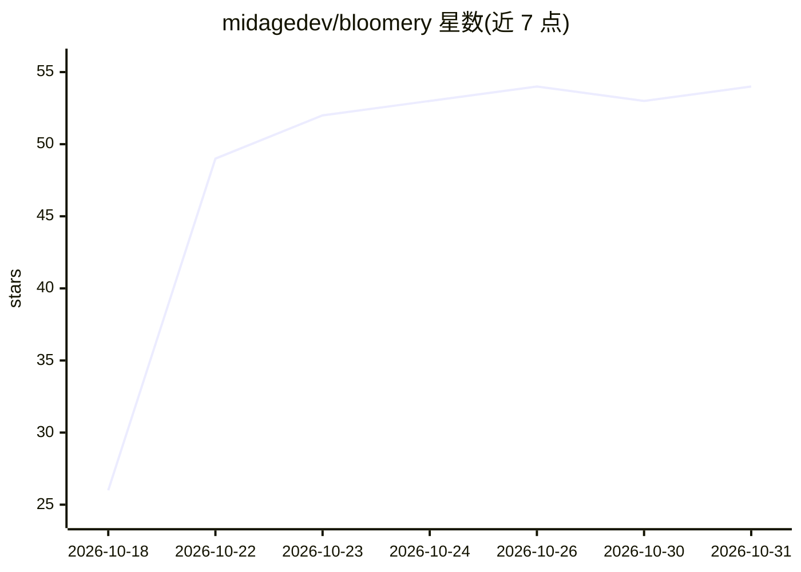

# midagedev/bloomery

⭐ 54 · Rust · MIT · 推送 2026-10-30 · [GitHub](https://github.com/midagedev/bloomery) · 个人维护

**面向 MoE 模型的 GPU+CPU 混合推理引擎，llama-server 兼容**

用 Rust 编写（含 CUDA 内核）的混合推理引擎，服务于超出显存甚至超出内存的 mixture-of-experts 模型：路由专家分布在 GPU 与主机内存，运行时统计调用并自适应迁移；内存不足时从 NVMe 模型文件分页。提供跨请求共享前缀的 prompt 缓存、--parallel 多请求单次通过、MTP 投机解码，兼容 llama-server 的 HTTP API（OpenAI/Anthropic）与 GGUF 文件。仅支持 Linux x86-64（Windows 需 WSL2）、NVIDIA sm_86+ 显卡与 R580+ 驱动；macOS 与 AMD GPU 暂不支持，各 seat 存在单槽位等限制。

## 筛选速览

| 维度 | 判定 | 备注 |
|---|---|---|
| AI 角色 | `ai-ecosystem` | LLM/agent 周边工具 |
| 许可风险 | `permissive` | MIT |
| 部署形态 | `desktop` | 安装包/桌面程序 |
| 模型依赖 | local-ok | 支持本地模型 |
| 硬件要求 | — | 无带数字的原话,不猜 |
| 安装摩擦 | `medium` | 含编译或系统依赖之一 |
| 成熟度 | — | 结构信号不足 |

## 能力要点

- 专家在 GPU/主机 RAM/NVMe 间分层放置并按路由热度自适应迁移
- 兼容 llama-server：同一 HTTP API（OpenAI 与 Anthropic）、GGUF 文件与 flag 拼写
- 跨请求存活的 prompt 前缀缓存（共享前缀恢复）
- CUDA 内核全部用 Rust 编写并经 cuda-oxide 编译

## 适用场景

- 在单张 24 GB 显卡上运行数百 GB 的 MoE 模型
- 替换 llama-server 而不改动现有客户端
- 通过 Anthropic 兼容端点供 Claude Code 调用本地模型

## 场景标签

`推理引擎` · 领域:训练与推理

## 证据(README 行号)

> L3:  A fast inference engine for mixture-of-experts models, built for offloading.
> L4:  Written in Rust from the HTTP server down to the CUDA kernels. A drop-in
> L20: - **llama-server compatible.** The same HTTP API (OpenAI and Anthropic), GGUF files and flag spellings: your client

## 星数曲线

2026-10-18 26 → 2026-10-31 54（+28）

---
*卡片 v1 · prompt 1.4 · 生成 2026-10-24 · 置信度 high · 依据 README sha `1f16df1d0d89` · [字段定义](../../DATASET.md)*
