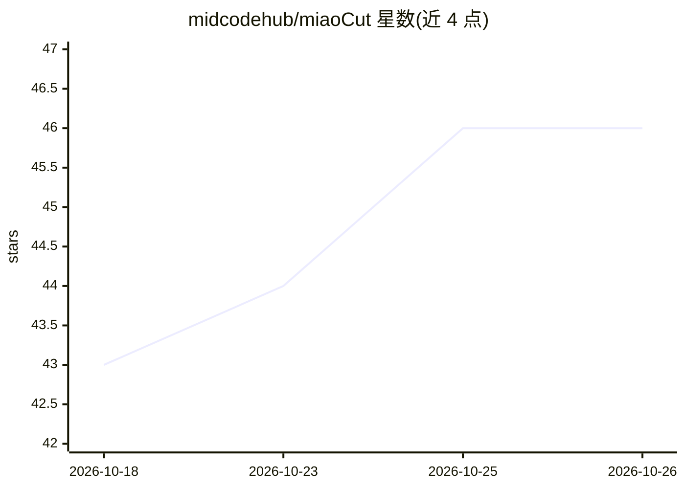

# midcodehub/miaoCut

⭐ 46 · HTML · MIT · 推送 2026-10-25 · [GitHub](https://github.com/midcodehub/miaoCut) · [官网](https://miaocut.app) · 个人维护 · 中文 README

**免注册的在线 AI 图像工具箱：一键抠图、去水印、老照片修复**

面向普通用户的免费在线 AI 图像处理工具箱：核心为一键背景移除（BiRefNet 分割模型，经 rembg 调用，INT8 量化），提供 Sharp（约 1 秒）与 Fur（alpha matting，3-5 秒）两种抠图模式；另含证件照制作（MediaPipe Face Mesh 裁剪）、去水印（LaMa 局部重绘）、老照片修复及格式转换。前端为静态页面（Cloudflare Pages），后端 FastAPI 单 worker，支持 Docker 与源码自部署（Python 3.11+/Node 18+）。图像仅在内存中处理、不存储、不用于训练。仓库部分 MIT 许可，站点的付费批量服务在另一私有仓库开发、未开源。

## 筛选速览

| 维度 | 判定 | 备注 |
|---|---|---|
| AI 角色 | `ai-native` | 本体是模型或模型工具 |
| 许可风险 | `permissive` | MIT |
| 部署形态 | `self-host` | docker 或自建部署 |
| 模型依赖 | — | README 未给出锁定关系 |
| 硬件要求 | — | 无带数字的原话,不猜 |
| 安装摩擦 | `low` | 无编译、无系统依赖或容器化 |
| 成熟度 | — | 结构信号不足 |

## 能力要点

- BiRefNet（INT8 量化）一键抠图，Sharp/Fur 双模式，输出原始分辨率透明 PNG
- LaMa 去水印、MediaPipe 证件照、老照片修复等系列工具
- 图像纯内存处理即弃，不存储、不用于训练
- 提供 Docker 镜像与源码自部署路径，限流与并发控制在进程内完成（无 Redis）

## 适用场景

- 上传照片一键去除背景并获得透明 PNG，无需注册
- 制作符合规格的证件照并更换底色
- 修复褪色老照片或用画笔涂抹去除水印

## 场景标签

`图像视频处理` · 领域:感知与多模态

## 证据(README 行号)

> L20: **MiaoCut** is a **free, no-signup online AI image toolkit**. Its core feature is **one-click background removal** 
> L61: │  HTML + Tailwind CSS + vanilla  │ ───▶ │  FastAPI + BiRefNet (rembg)         │
> L68: - **Backend** — FastAPI (single worker). AI models: **BiRefNet-General-Lite** (INT8 quantized) via rembg for cutout

## 星数曲线

2026-10-18 43 → 2026-10-26 46（+3）

---
*卡片 v1 · prompt 1.4 · 生成 2026-10-25 · 置信度 mid · 依据 README sha `c40d6de84788` · [字段定义](../../DATASET.md)*
