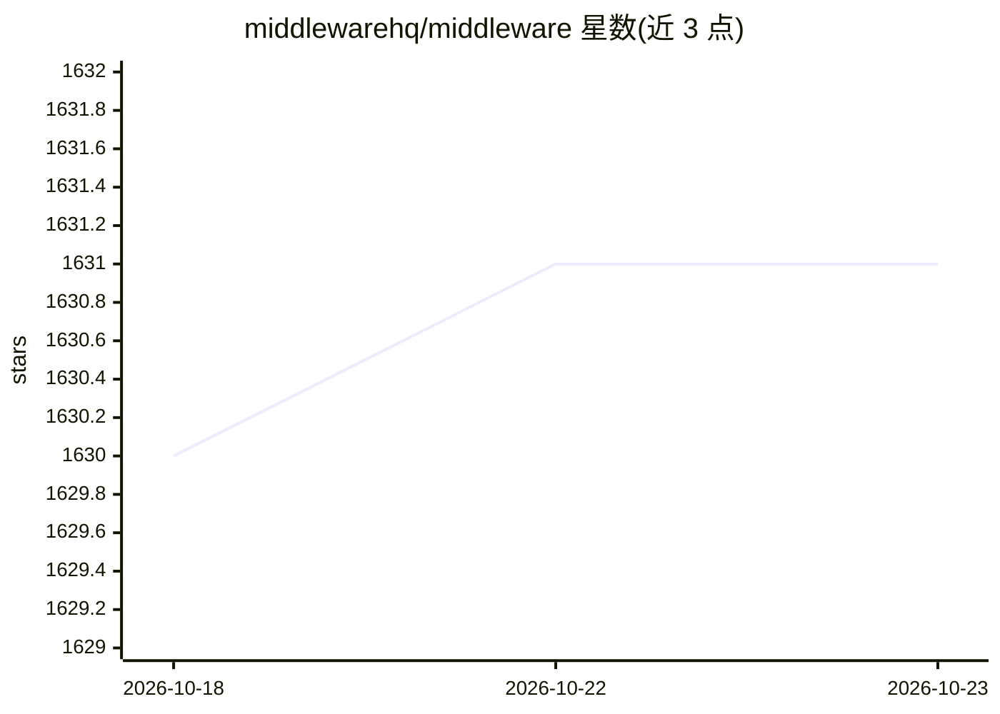

# middlewarehq/middleware

⭐ 1,631 · TypeScript · Apache-2.0 · 推送 2026-08-03 · [GitHub](https://github.com/middlewarehq/middleware) · [官网](https://middlewarehq.com) · 组织维护

**面向工程管理者的开源 DORA 指标度量与分析平台**

Middleware 帮助工程负责人度量与分析团队效能：通过 PAT 令牌接入代码托管平台，基于 Pull Request、部署与事故数据自动计算四项 DORA 指标（部署频率、变更前置时间、平均恢复时间、变更失败率），并提供可视化看板、可定制报表及 CI/CD 与项目管理平台集成。以 Docker 单容器方式部署，本地访问 localhost:3333；开发者可经 GitPod、Docker Compose 或手动搭建（Python 3.11.6 + Node.js 22.x + Postgres + Redis）。README 未展示 AI 功能细节，仅仓库主题含 ai 标签。

## 筛选速览

| 维度 | 判定 | 备注 |
|---|---|---|
| AI 角色 | `ai-enhanced` | 去掉 AI 部分产品仍成立 |
| 许可风险 | `permissive` | Apache-2.0 |
| 部署形态 | `self-host` | docker 或自建部署 |
| 模型依赖 | — | README 未给出锁定关系 |
| 硬件要求 | — | 无带数字的原话,不猜 |
| 安装摩擦 | `low` | 无编译、无系统依赖或容器化 |
| 成熟度 | — | 结构信号不足 |

## 能力要点

- 基于 Git 数据自动采集与计算四项 DORA 指标
- 可视化 KPI 与可定制的报表、仪表盘
- 支持事故过滤、排除 PR、生产分支等设置以提升数据准确性
- Docker 单容器部署，也可 GitPod/手动搭建开发环境

## 适用场景

- 工程负责人查看团队的 DORA 指标与交付效能
- 通过 PR 与部署数据定位交付瓶颈
- 生成面向管理层的工程效能报表

## 场景标签

 · 领域:研发效能/工程管理分析

## 证据(README 行号)

> L17: **Middleware** is an open-source tool designed to help engineering leaders measure and analyze the effectiveness of
> L307: Middleware can display DORA Metrics using exclusively Pull Requests based data. The aim is to provide Dora Metrics

## 星数曲线

2026-10-18 1,630 → 2026-10-23 1,631（+1）

---
*卡片 v1 · prompt 1.4 · 生成 2026-10-21 · 置信度 low · 依据 README sha `5af655a094fb` · [字段定义](../../DATASET.md)*
