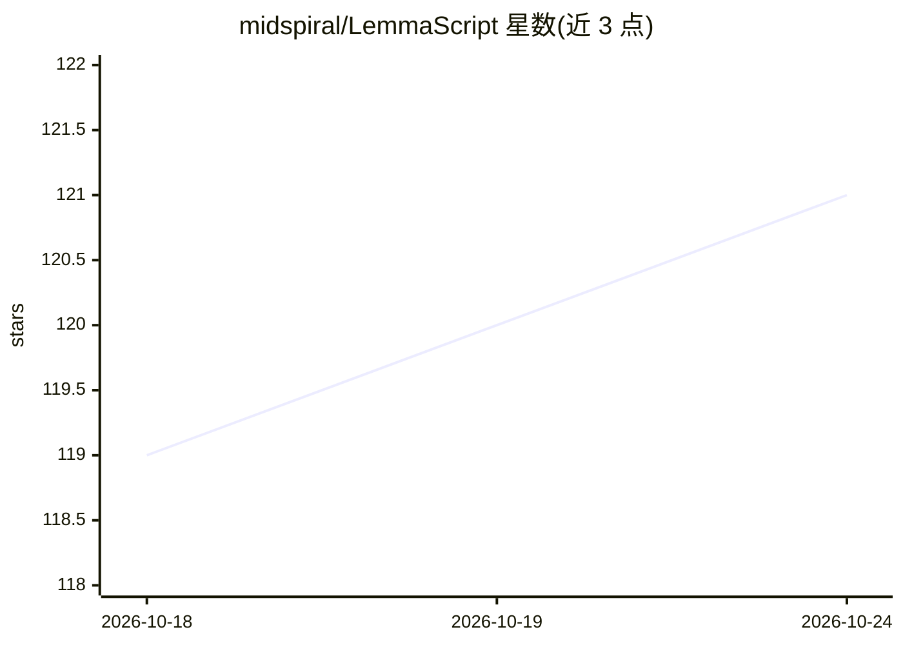

# midspiral/LemmaScript

⭐ 122 · TypeScript · MIT · 推送 2026-10-16 · [GitHub](https://github.com/midspiral/LemmaScript) · [官网](https://lemmascript.org) · 组织维护

**带规范注解的 TypeScript 形式化验证工具链**

在普通 TypeScript 中以 //@ 注解写入规范，由工具链生成可验证代码并转交 Dafny 或 Lean 4（Velvet 2）证明器检验。README 列出十余个从同一注解源验证的内外部案例：新开发应用（React/Next.js 域模型）与存量库（casbin、hono、xyflow、balanced-match 等）的就地验证，覆盖不变式保持、守恒定理、完备性等性质。当前为 Tech Preview，语义与易用性仍在演进。面向 TypeScript 开发者与形式化验证使用者。

## 筛选速览

| 维度 | 判定 | 备注 |
|---|---|---|
| AI 角色 | `ai-enhanced` | 去掉 AI 部分产品仍成立 |
| 许可风险 | `permissive` | MIT |
| 部署形态 | `library` | 以包/库形式分发 |
| 模型依赖 | — | README 未给出锁定关系 |
| 硬件要求 | — | 无带数字的原话,不猜 |
| 安装摩擦 | `low` | 无编译、无系统依赖或容器化 |
| 成熟度 | `idea` | |

## 能力要点

- 从同一注解 TypeScript 源生成 Dafny 与 Lean 4 可验证代码
- 支持存量库的就地验证（casbin、hono、xyflow、balanced-match 等案例）
- 案例覆盖不变式保持、守恒定理、可靠性与完备性证明
- 验证条件可全部机械检验（案例报告 0 errors、0 sorry）

## 适用场景

- 为 TypeScript 业务域模型附加机器检验的不变式与守恒证明
- 对存量 npm 依赖库的核心函数做就地形式化验证
- 在同一份源码上同时产出 Dafny 与 Lean 4 证明

## 场景标签

 · 领域:软件工程/形式化验证

## 证据(README 行号)

> L3: A verification toolchain for TypeScript. Write ordinary TypeScript with `//@ ` specification annotations. The toolch
> L7: This is a **Tech Preview**: the core idea is there, but support, semantics, and ergonomics are still evolving.

## 星数曲线

2026-10-18 119 → 2026-10-24 121（+2）

---
*卡片 v1 · prompt 1.4 · 生成 2026-10-23 · 置信度 low · 依据 README sha `74b0bb7dd2fd` · [字段定义](../../DATASET.md)*
