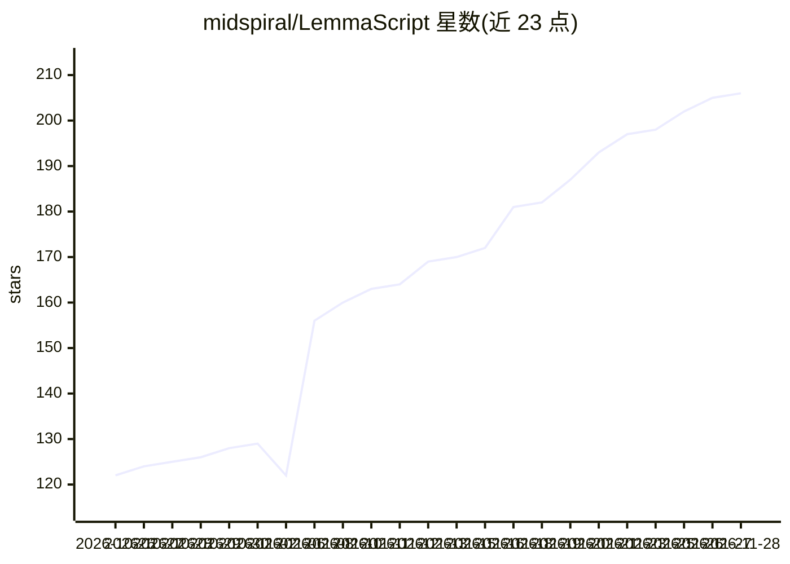

# midspiral/LemmaScript

⭐ 206 · TypeScript · MIT · 推送 2026-11-27 · [GitHub](https://github.com/midspiral/LemmaScript) · [官网](https://lemmascript.org) · 个人维护

**为 TypeScript 程序生成 Dafny/Lean 可验证代码的验证工具链**

面向 TypeScript 开发者的程序验证工具链：开发者在普通 TypeScript 代码中以 `//@ ` 注解书写前置/后置条件、不变式等规约，工具链据此生成 Dafny 或 Lean 4（Velvet 2）形式的可验证代码，并经 `lsc gen/check` 生成与核验。Dafny 后端采用 .dfy.gen（可再生）与 .dfy（含人工/LLM 补充证明）双文件结构，要求差异仅为新增。附带 claimcheck 自然语言契约核对、guard 运行时前置条件检查，以及可复用的 GitHub Actions CI 工作流。npm 提供 Tech Preview 安装包。

## 筛选速览

| 维度 | 判定 | 备注 |
|---|---|---|
| AI 角色 | `ai-enhanced` | 去掉 AI 部分产品仍成立 |
| 许可风险 | `permissive` | MIT |
| 部署形态 | `library` | 以包/库形式分发 |
| 模型依赖 | — | README 未给出锁定关系 |
| 硬件要求 | — | 无带数字的原话,不猜 |
| 安装摩擦 | `low` | 无编译、无系统依赖或容器化 |
| 成熟度 | `idea` | |

## 能力要点

- TypeScript 注解（requires/ensures/invariant/decreases）生成 Dafny 或 Lean 4 可验证代码
- lsc check 可按 LemmaScript-files.txt 批量核验，本地与 CI 验证同一文件集
- 提供可复用 GitHub Actions 工作流，检测生成文件过期并阻断构建
- claimcheck 核对自然语言契约、guard 生成运行时前置条件检查模块

## 适用场景

- 为 TypeScript 库或应用补充形式化规约并做验证
- 在 CI 中自动验证提交的生成证明未过期
- 用 guard 在应用边界做运行时前置条件检查

## 场景标签

`代码生成` `代码审查` · 领域:编码与开发

## 证据(README 行号)

> L3: A verification toolchain for TypeScript. Write ordinary TypeScript with `//@ ` specification annotations. The toolch
> L9: This is a **Tech Preview**: the core idea is there, but support, semantics, and ergonomics are still evolving.
> L64: The Dafny backend generates two files per TS source: `foo.dfy.gen` (always regeneratable) and `foo.dfy` (source of 

## 星数曲线

2026-10-26 122 → 2026-11-28 206（+84）

---
*卡片 v1 · prompt 1.4 · 生成 2026-11-25 · 置信度 mid · 依据 README sha `0ad57f070ade` · [字段定义](../../DATASET.md)*
