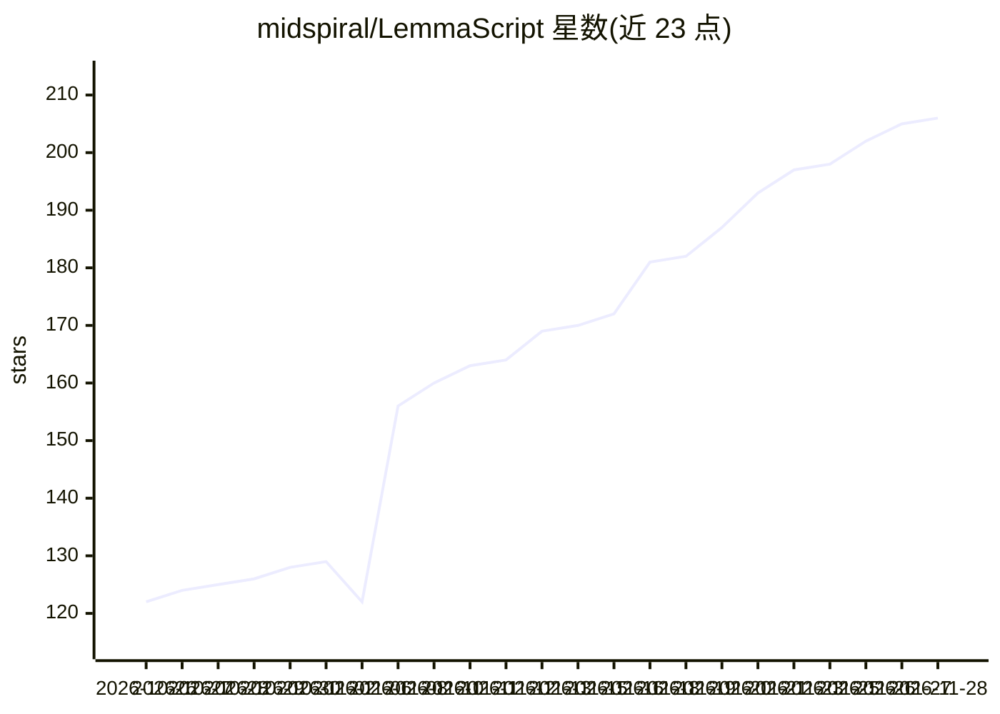

# midspiral/LemmaScript

⭐ 206 · TypeScript · MIT · 推送 2026-11-27 · [GitHub](https://github.com/midspiral/LemmaScript) · [官网](https://lemmascript.org) · 个人维护

**为 TypeScript 代码加规格注解并生成可验证的 Dafny/Lean 证明**

面向 TypeScript 开发者的验证工具链：在普通 TypeScript 代码中以 `//@ ` 注解书写前置/后置条件、不变式等规格，由 lsc 命令生成 Dafny 或 Lean 4（Velvet 2）后端的可验证代码，支持 gen/check/regen 流程。Dafny 后端采用双文件机制，生成文件与含 LLM/人工证明补充的源文件需保持仅增量差异；另提供运行时前置条件检查（guard）与自然语言契约核对（claimcheck）子命令。当前为 Tech Preview，语义与支持仍在演进，依赖 Node.js >= 18 及对应后端工具链。

## 筛选速览

| 维度 | 判定 | 备注 |
|---|---|---|
| AI 角色 | `ai-enhanced` | 去掉 AI 部分产品仍成立 |
| 许可风险 | `permissive` | MIT |
| 部署形态 | `library` | 以包/库形式分发 |
| 模型依赖 | — | README 未给出锁定关系 |
| 硬件要求 | — | 无带数字的原话,不猜 |
| 安装摩擦 | `low` | 无编译、无系统依赖或容器化 |
| 成熟度 | `idea` | |

## 能力要点

- TypeScript `//@ ` 规格注解生成 Dafny 或 Lean 4 可验证代码
- 双后端支持，GitHub Actions 可复用工作流验证 CI 产物
- guard 子命令生成运行时前置条件检查模块
- 生成文件与证明文件仅增量差异的 diff 约束机制

## 适用场景

- 为关键 TypeScript 业务逻辑添加形式化验证
- 在 CI 中批量验证带规格注解的源码清单
- 对自然语言契约与形式化规格做一致性核对

## 场景标签

 · 领域:开发者工具/程序验证

## 证据(README 行号)

> L3: A verification toolchain for TypeScript. Write ordinary TypeScript with `//@ ` specification annotations. The toolch
> L64: The Dafny backend generates two files per TS source: `foo.dfy.gen` (always regeneratable) and `foo.dfy` (source of 
> L9: This is a **Tech Preview**: the core idea is there, but support, semantics, and ergonomics are still evolving.

## 星数曲线

2026-10-26 122 → 2026-11-28 206（+84）

---
*卡片 v1 · prompt 1.4 · 生成 2026-11-28 · 置信度 high · 依据 README sha `686db5a97f26` · [字段定义](../../DATASET.md)*
