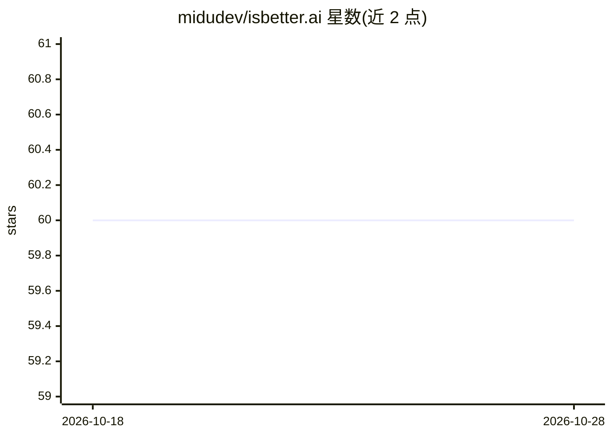

# midudev/isbetter.ai

⭐ 60 · TypeScript · NOASSERTION · 推送 2026-10-13 · [GitHub](https://github.com/midudev/isbetter.ai) · [官网](https://isbetter.ai) · 个人维护

**浏览器内并排对比 AI 模型输出的对战工具**

基于 Astro + Cloudflare Workers 的模型对比应用：同一提示词同时发给最多 6 个模型，实时流式展示原始输出、抽取代码与沙箱化实时预览，并统计总耗时、首 token 时间、生成速度、token 数与预估成本；支持盲测模式隐藏模型身份、分享对战链接与本地历史。用户自带 API key，密钥、提示词与历史存于浏览器 localStorage，不经服务器；支持 OpenRouter、OpenAI、Anthropic、Gemini、xAI、DeepSeek、Mistral、Groq、Cerebras 及任意 OpenAI 兼容本地服务。

## 筛选速览

| 维度 | 判定 | 备注 |
|---|---|---|
| AI 角色 | `ai-ecosystem` | LLM/agent 周边工具 |
| 许可风险 | `none` | NOASSERTION |
| 部署形态 | `library` | 以包/库形式分发 |
| 模型依赖 | local-ok | 支持本地模型 |
| 硬件要求 | — | 无带数字的原话,不猜 |
| 安装摩擦 | `low` | 无编译、无系统依赖或容器化 |
| 成熟度 | — | 结构信号不足 |

## 能力要点

- 同一提示词并排运行最多 6 个模型，流式实时输出
- 每个结果三种视图：原始输出、提取代码、沙箱实时预览
- 对战指标：耗时、首 token 时间、速度、token 与预估成本
- API key 仅存 localStorage，只发送给对应 provider

## 适用场景

- 给多个模型发同一提示词，对比回答质量与成本
- 盲测模式下不带品牌偏见地评估模型输出
- 分享对战链接与他人复核结果

## 场景标签

`模型评测` · 领域:评测与运维

## 证据(README 行号)

> L5: Give every model the same prompt and compare the answer, the generated code, a live preview, speed, tokens and cost 
> L11: - **Side-by-side battles** — run one prompt against up to 6 models at once and watch every answer stream in.
> L14: - **Battle metrics** — total time, time to first token, generation speed, tokens and estimated cost, with a timelin

## 星数曲线

2026-10-18 60 → 2026-10-28 60（+0）

---
*卡片 v1 · prompt 1.4 · 生成 2026-10-24 · 置信度 mid · 依据 README sha `444bd50e4145` · [字段定义](../../DATASET.md)*
