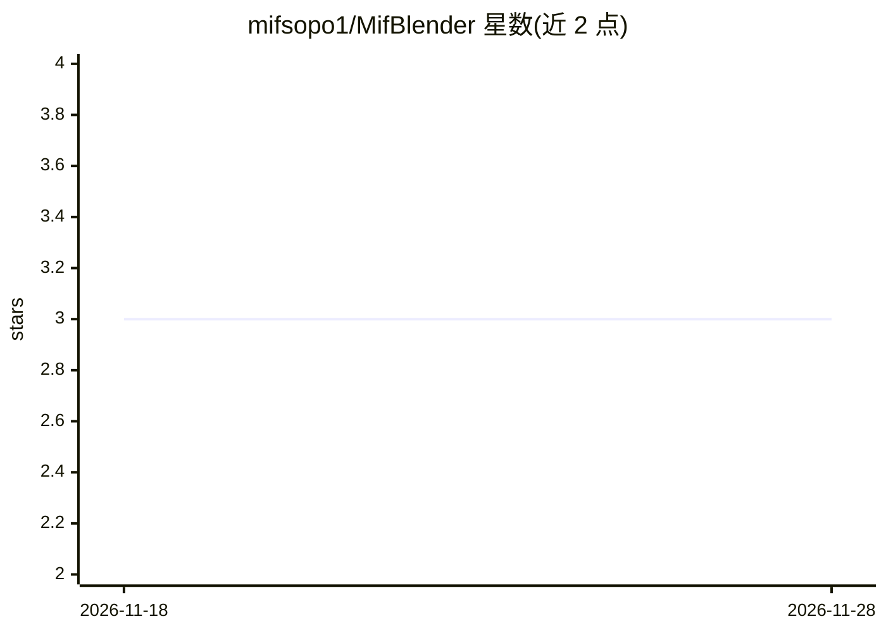

# mifsopo1/MifBlender

⭐ 3 · Python · NOASSERTION · 推送 2026-11-27 · [GitHub](https://github.com/mifsopo1/MifBlender) · [官网](https://mifshowcase.store/mifblender) · 个人维护

**在运行中的 Blender 内工作的 AI 助手：437 个带类型检查的 MCP 工具**

以 Blender 插件与 MCP 服务器形式提供，将建模、材质与 UV、绑定动画、物理模拟、几何节点、渲染等 437 个类型化工具暴露给 AI 客户端；每个工具检查参数、在 Blender 主线程执行并回读结果。提供 uvx 一行式安装，自动检测 Blender 与 AI 应用并完成配置。默认精简模式仅加载 3 个工具按需查找，支持环境变量配置端口、令牌与超时；本地运行，run_python 与生成式工具可在偏好中关闭。

## 筛选速览

| 维度 | 判定 | 备注 |
|---|---|---|
| AI 角色 | `ai-native` | 本体是模型或模型工具 |
| 许可风险 | `none` | NOASSERTION |
| 部署形态 | `library` | 以包/库形式分发 |
| 模型依赖 | — | README 未给出锁定关系 |
| 硬件要求 | — | 无带数字的原话,不猜 |
| 安装摩擦 | `low` | 无编译、无系统依赖或容器化 |
| 成熟度 | — | 结构信号不足 |

## 能力要点

- 437 个类型化 MCP 工具覆盖建模/材质/UV/绑定/动画/物理/几何节点/渲染
- 每个工具检查参数、在 Blender 主线程执行并回读结果
- 精简默认仅暴露 find_tools/mif_call/run_python，按需加载其余工具，共 14 个工具包
- setup 命令自动安装插件并接入 Claude Code、Claude Desktop、Cursor、Windsurf、VS Code、Codex

## 适用场景

- 用自然语言驱动 Blender 完成建模、材质烘焙、绑定与渲染
- 让 AI 会话中迭代生成游戏资产与场景道具
- 将渲染结果与参考图对比做自动化检查

## 场景标签

`AI 助手` · 领域:对话与助手

## 证据(README 行号)

> L5:  Your AI assistant, working inside a running Blender.
> L7: Each one checks its parameters, does the work on Blender's main thread and reads the result back.
> L202: `setup` knows Claude Code, Claude Desktop, Cursor, Windsurf, VS Code and Codex. For any other MCP client, start th

## 星数曲线

2026-11-18 3 → 2026-11-28 3（+0）

---
*卡片 v1 · prompt 1.4 · 生成 2026-11-21 · 置信度 high · 依据 README sha `66dd4b1ce0b2` · [字段定义](../../DATASET.md)*
