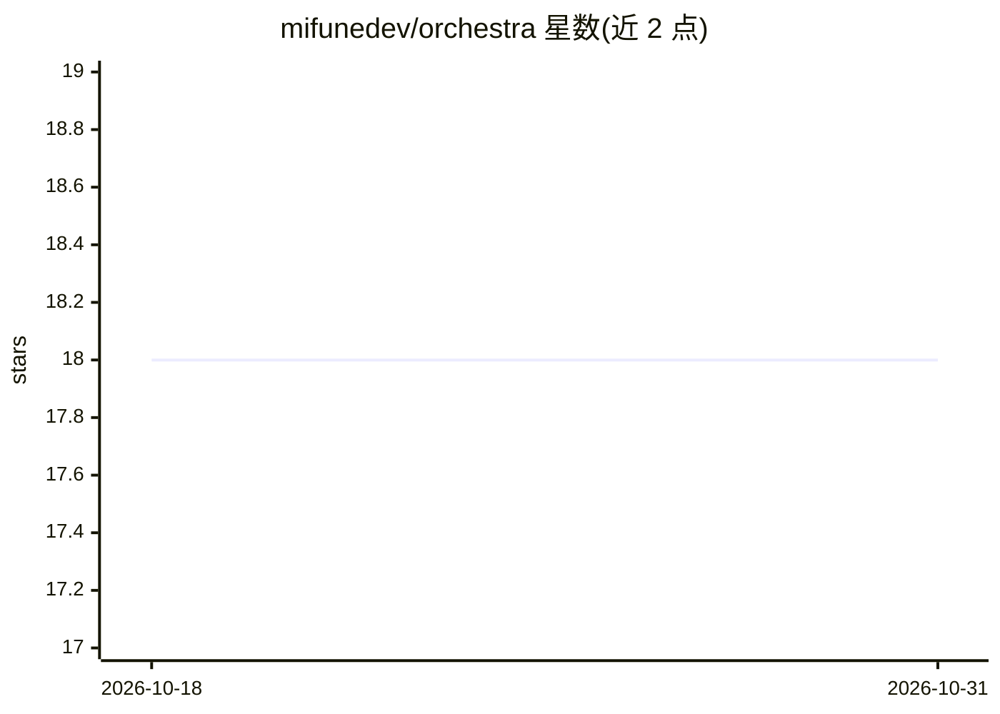

# mifunedev/orchestra

⭐ 18 · Python · Apache-2.0 · 推送 2026-09-29 · [GitHub](https://github.com/mifunedev/orchestra) · [官网](https://mifune.dev) · 组织维护

**给开发者的开源 AI agent 编排平台，基于 LangGraph 与 MCP/A2A**

自托管的 AI agent 编排平台：Python FastAPI 后端（uvicorn 运行）承载 LangGraph agent，PostgreSQL + pgvector 存储、Alembic 迁移，React/Vite 提供浏览器客户端，TaskIQ + Redis 处理分布式执行，MinIO 或 S3 存文件。支持通过 MCP 连接服务器、通过 A2A 连接 agent 端点，可配置 agent 的模型、工具、技能与仓库指令文件。社区版免费自托管（Docker 镜像），另有托管云与企业版（需联系）。快速启动需 Docker、Python 3.12+、Node.js 与 uv。

## 筛选速览

| 维度 | 判定 | 备注 |
|---|---|---|
| AI 角色 | `ai-ecosystem` | LLM/agent 周边工具 |
| 许可风险 | `permissive` | Apache-2.0 |
| 部署形态 | `self-host` | docker 或自建部署 |
| 模型依赖 | — | README 未给出锁定关系 |
| 硬件要求 | — | 无带数字的原话,不猜 |
| 安装摩擦 | `low` | 无编译、无系统依赖或容器化 |
| 成熟度 | — | 结构信号不足 |

## 能力要点

- 基于 LangGraph 构建，支持 MCP 与 A2A 协议接入
- FastAPI + PostgreSQL/pgvector + React/Vite + TaskIQ/Redis 技术栈
- 提供 Docker 镜像免费自托管，含托管云与企业版选项
- 支持 agent 技能打包、仓库指令文件（AGENTS.md）与内置工具目录

## 适用场景

- 自托管一个可连接多模型与 MCP 工具的 agent 平台
- 通过 A2A 端点将外部 agent 接入统一界面管理
- 企业内私有化部署 agent 基础设施

## 场景标签

`Agent 框架` `多智能体` · 领域:Agent 开发

## 证据(README 行号)

> L16: **Open-source AI agent orchestration platform** built on LangGraph and powered by the MCP & A2A protocols.
> L20: The stack is a Python FastAPI backend that runs under uvicorn, LangGraph agents, and Alembic

## 星数曲线

2026-10-18 18 → 2026-10-31 18（+0）

---
*卡片 v1 · prompt 1.4 · 生成 2026-10-29 · 置信度 mid · 依据 README sha `6943348e785b` · [字段定义](../../DATASET.md)*
