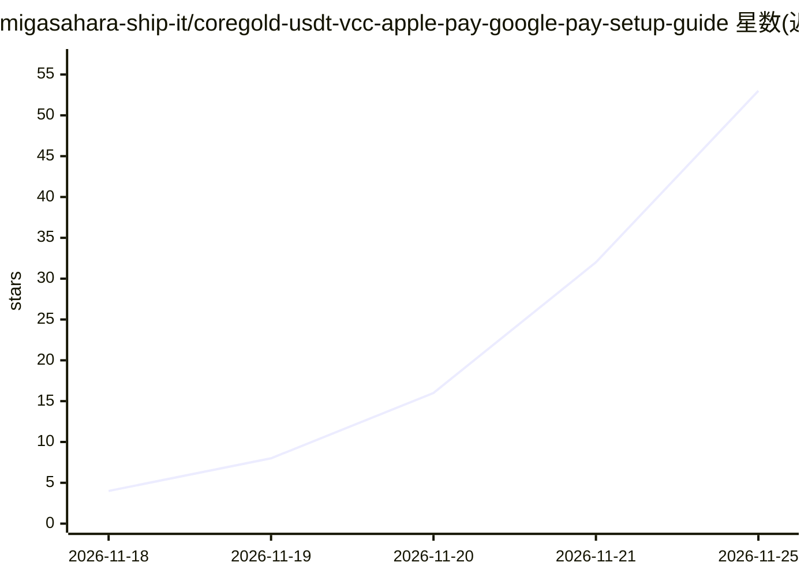

# migasahara-ship-it/coregold-usdt-vcc-apple-pay-google-pay-setup-guide

⭐ 53 · 推送 2026-11-17 · [GitHub](https://github.com/migasahara-ship-it/coregold-usdt-vcc-apple-pay-google-pay-setup-guide) · [官网](https://app.coregold.io/signup?invite_code=ADvlj9b) · 个人维护 · 中文 README

**Coregold 虚拟卡申请、USDT 充值与绑定 Apple/Google Pay 的教程**

面向个人用户的操作指南文档：按七个步骤讲解 Coregold 虚拟卡的注册、USDT（TRC20）充值、选择开卡套餐、填写账单信息、查看卡片信息及绑定 Apple Pay / Google Pay 的流程，并附常见问题解答。内容为纯图文教程，不含代码或软件安装环节；注册链接中带有邀请码。卡片分类覆盖 ChatGPT、Claude 等 AI 工具付费、海外应用商店、电商广告及云服务等场景。

## 筛选速览

| 维度 | 判定 | 备注 |
|---|---|---|
| AI 角色 | `ai-knowledge` | 知识聚合/清单类 |
| 许可风险 | `none` | — |
| 部署形态 | `None` |  |
| 模型依赖 | — | README 未给出锁定关系 |
| 硬件要求 | — | 无带数字的原话,不猜 |
| 安装摩擦 | `low` | 无编译、无系统依赖或容器化 |
| 成熟度 | — | 结构信号不足 |

## 能力要点

- 七步流程覆盖注册、充值、开卡到数字钱包绑定
- 支持 USDT TRC20 网络充值并附操作清单
- 卡片按使用场景分类，均为美国发行卡 BIN
- 绑定数字钱包的验证码需返回 Coregold 后台获取

## 适用场景

- 想用 USDT 充值开通虚拟卡用于订阅海外服务
- 需要把虚拟卡添加到 Apple Pay 或 Google Pay
- 不了解 TRC20 充值操作，需要一步步指引

## 场景标签

`教程课程` · 领域:学习与行业

## 证据(README 行号)

> L5: **coregold开卡-充值-绑定Apple Pay&Google Pay指南**
> L9: 本教程将带你完成 CoreGold 从注册、充值、申请开卡到绑定数字钱包的全部操作。

## 星数曲线

2026-11-18 4 → 2026-11-25 53（+49）

---
*卡片 v1 · prompt 1.4 · 生成 2026-11-20 · 置信度 high · 依据 README sha `adc6334cd369` · [字段定义](../../DATASET.md)*
