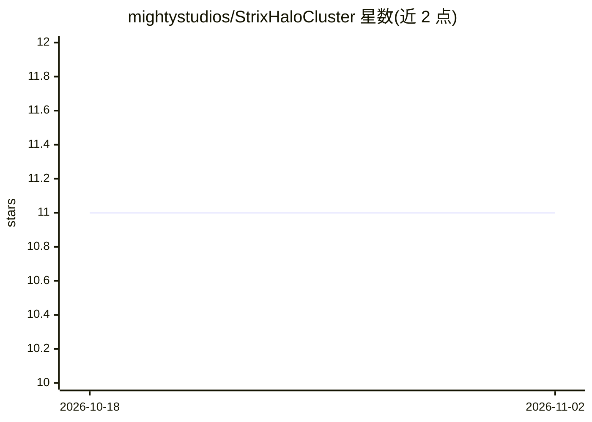

# mightystudios/StrixHaloCluster

⭐ 11 · Shell · 推送 2026-10-09 · [GitHub](https://github.com/mightystudios/StrixHaloCluster) · 个人维护

**两台 AMD Strix Halo 迷你主机组建本地 AI 推理集群的配置脚本集**

面向 Bosgame M5（128GB Strix Halo）双节点的一键部署脚本：在全新 Ubuntu 上完成 USB4 私有链路、ROCm、llama.cpp 编译、Qwen3.8-Flash-Next 多用户推理服务（llama-server + RPC worker）与双节点 ComfyUI（共享工作区、SMB/NFS、Hunyuan3D SDPA 兼容补丁）的安装，另含集群监控面板。默认配置服务两名并发 LLM 用户加一名 ComfyUI 用户。限制：仅适配该硬件与 Sixunited AXB35 主板系统，面向可信局域网，共享目录匿名读写且未做安全加固，Q5/Q6 量化在此拓扑上标注为实验性。

## 筛选速览

| 维度 | 判定 | 备注 |
|---|---|---|
| AI 角色 | `ai-ecosystem` | LLM/agent 周边工具 |
| 许可风险 | `none` | — |
| 部署形态 | `desktop` | 安装包/桌面程序 |
| 模型依赖 | local-ok | 支持本地模型 |
| 硬件要求 | — | 无带数字的原话,不猜 |
| 安装摩擦 | `medium` | 含编译或系统依赖之一 |
| 成熟度 | — | 结构信号不足 |

## 能力要点

- 两条脚本路径完成环境、Qwen 推理服务与双节点 ComfyUI 部署，可安全重跑
- USB4 TCP-over-USB4 私有链路连接双节点（实测约 9Gbps），worker 经 RPC 提供 GPU 层
- ComfyUI 共享工作区经 SMB 暴露给 Windows 客户端，含 Hunyuan3D 在 Radeon 8060S 上的 Math SDPA 回退补丁
- 独立 Gradio 集群面板提供遥测、容量测试与令牌速率统计

## 适用场景

- 我有两台 Strix Halo 迷你主机，想快速搭一个多人共用的本地 LLM + ComfyUI 服务
- 家庭/工作室局域网内为多个用户提供 Qwen 推理和图像生成服务
- 监控双节点集群的健康状态与 USB4 链路吞吐

## 场景标签

`推理引擎` `图像生成` · 领域:内容生成

## 证据(README 行号)

> L5: This instance uses two 128 GB AMD Strix Halo PCs (Bosgame M5 nodes) linked over USB4 as a private AI cluster. The de
> L52:     web --> llama["Controller llama-server Qwen3.8-Flash-Next"]
> L142: |`setup-qwen3d8.sh`|ROCm, `llama.cpp`, Qwen3.8 model, RPC services, and controller web UI|

## 星数曲线

2026-10-18 11 → 2026-11-02 11（+0）

---
*卡片 v1 · prompt 1.4 · 生成 2026-11-02 · 置信度 high · 依据 README sha `f6d4575b80aa` · [字段定义](../../DATASET.md)*
