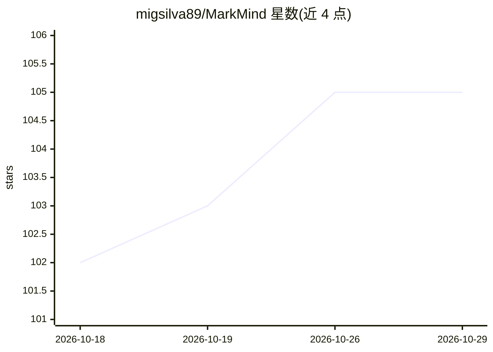

# migsilva89/MarkMind

⭐ 105 · TypeScript · 推送 2026-09-19 · [GitHub](https://github.com/migsilva89/MarkMind) · [官网](https://www.markmind.xyz/) · 个人维护

**用 AI 自动整理浏览器书签的 Chrome 扩展**

面向普通浏览器用户的 Chrome 扩展：读取书签的标题与 URL，调用 AI（Gemini/OpenAI/Anthropic/OpenRouter）分析并建议归入的文件夹，支持一键整理当前页面或批量整理数百上千条书签，散落在文件夹外的书签也纳入处理，并可发现与清理重复书签。所有 AI 建议需用户审核后应用；书签数据保留在浏览器内，仅标题/URL 发送给 AI，API key 存于 Chrome 本地存储，无遥测。开发者可从源码构建，基于 React 19 + Vite + Manifest V3。

## 筛选速览

| 维度 | 判定 | 备注 |
|---|---|---|
| AI 角色 | `ai-native` | 本体是模型或模型工具 |
| 许可风险 | `none` | — |
| 部署形态 | `library` | 以包/库形式分发 |
| 模型依赖 | locked-api |  |
| 硬件要求 | — | 无带数字的原话,不猜 |
| 安装摩擦 | `low` | 无编译、无系统依赖或容器化 |
| 成熟度 | — | 结构信号不足 |

## 能力要点

- AI 分析页面内容并建议归属文件夹，支持批量整理
- 多 AI 提供商支持：Gemini / OpenAI / Anthropic / OpenRouter
- 重复书签检测与清理，散落书签一并整理
- 书签不出浏览器，仅标题/URL 送 AI，无遥测

## 适用场景

- 一键把正在浏览的页面归入合适的书签文件夹
- 批量整理堆积多年的杂乱书签
- 扫描并清理重复保存的书签

## 场景标签

`知识库管理` · 领域:知识与检索

## 证据(README 行号)

> L25: MarkMind uses AI to understand what you're saving and automatically organizes your bookmarks into the right folders
> L32: - **Smart Organization** - AI analyzes page content and suggests the best folder

## 星数曲线

2026-10-18 102 → 2026-10-29 105（+3）

---
*卡片 v1 · prompt 1.4 · 生成 2026-10-23 · 置信度 high · 依据 README sha `ec98522de2a9` · [字段定义](../../DATASET.md)*
