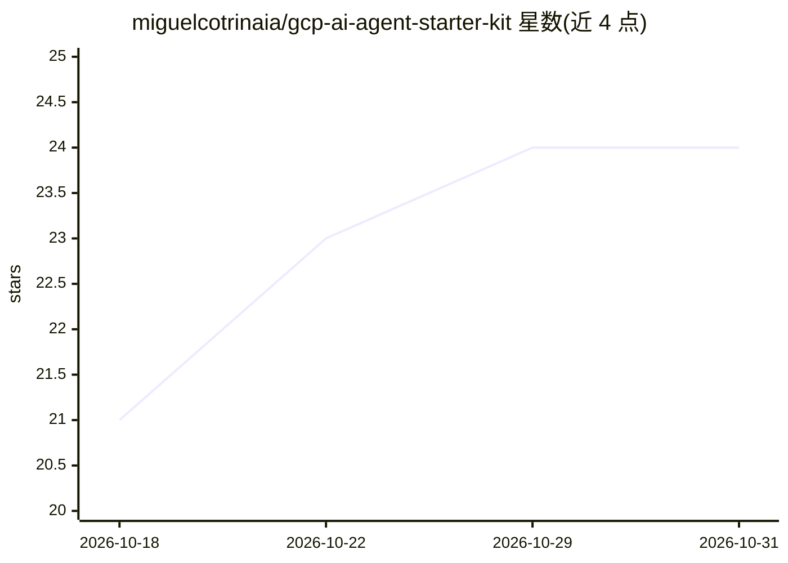

# miguelcotrinaia/gcp-ai-agent-starter-kit

⭐ 24 · Jupyter Notebook · 推送 2026-10-12 · [GitHub](https://github.com/miguelcotrinaia/gcp-ai-agent-starter-kit) · 个人维护

**在 GCP 上构建 LangChain RAG 智能体的教学系列仓库（13 集）**

一个围绕 13 集视频系列（00–12）组织的学习型仓库，教授如何在 Google Cloud 上构建、集成并部署对话式 AI agent：使用 LangChain + LangGraph 做编排、Elasticsearch 做 RAG 检索、Cloud SQL for PostgreSQL 做对话记忆、OpenAI 提供模型与 embedding，前后端均部署在 Cloud Run，观测依赖 LangSmith。仓库按集提供 README、notebooks 与脚本，另有 backend 服务代码目录 cloud-run-service 与旧版 1.0 工作坊材料。使用 GCP 资源可能产生费用；后端实现将在系列中逐步完成。

## 筛选速览

| 维度 | 判定 | 备注 |
|---|---|---|
| AI 角色 | `ai-knowledge` | 知识聚合/清单类 |
| 许可风险 | `none` | — |
| 部署形态 | `None` |  |
| 模型依赖 | — | README 未给出锁定关系 |
| 硬件要求 | — | 无带数字的原话,不猜 |
| 安装摩擦 | `low` | 无编译、无系统依赖或容器化 |
| 成熟度 | — | 结构信号不足 |

## 能力要点

- 13 集系列，覆盖架构、Elasticsearch、RAG、记忆、密钥管理、部署、测试与成本
- 架构表明确列出 9 个组件及其 GCP/第三方技术选型
- 两种可选前端（匿名/Google 登录），各自独立仓库
- 保留旧版 1.0 工作坊材料并分离新版本

## 适用场景

- 跟着系列学习在 Google Cloud 上从零部署带记忆和 RAG 的 LLM agent
- 参考架构表与各集 README 搭建自己的 GCP agent 方案
- 了解 LangGraph、Elasticsearch RAG 与 Cloud Run 的集成方式

## 场景标签

`教程课程` · 领域:学习与行业

## 证据(README 行号)

> L5: Este repositorio es el **punto de entrada de una serie práctica de 13 episodios (00–12)**, más un video de bienvenid
> L41: La **bienvenida** presenta el proyecto, los tres repositorios, la arquitectura final y lo que se construirá. No lle

## 星数曲线

2026-10-18 21 → 2026-10-31 24（+3）

---
*卡片 v1 · prompt 1.4 · 生成 2026-10-27 · 置信度 high · 依据 README sha `617a7cf47c07` · [字段定义](../../DATASET.md)*
