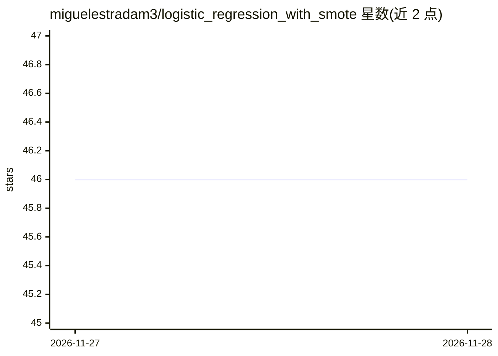

# miguelestradam3/logistic_regression_with_smote

⭐ 46 · Jupyter Notebook · MIT · 推送 2026-11-25 · [GitHub](https://github.com/miguelestradam3/logistic_regression_with_smote) · 个人维护

**用逻辑回归与 SMOTE 预测人格类型的机器学习教学笔记本**

一个 Jupyter Notebook 项目，演示基于输入特征预测人格类型的完整机器学习流程：EDA 与 Seaborn 可视化、LabelEncoder 类别编码、StandardScaler 特征标准化、SMOTE 处理类别不平衡、逻辑回归训练与测试集划分。评估环节输出 Accuracy、Precision、Recall、ROC-AUC、混淆矩阵与 ROC 曲线。数据集为合成人格数据集。README 未附数据集获取说明，安装依赖后按顺序运行笔记本单元格即可复现流程。

## 筛选速览

| 维度 | 判定 | 备注 |
|---|---|---|
| AI 角色 | `ai-knowledge` | 知识聚合/清单类 |
| 许可风险 | `permissive` | MIT |
| 部署形态 | `library` | 以包/库形式分发 |
| 模型依赖 | — | README 未给出锁定关系 |
| 硬件要求 | — | 无带数字的原话,不猜 |
| 安装摩擦 | `low` | 无编译、无系统依赖或容器化 |
| 成熟度 | — | 结构信号不足 |

## 能力要点

- SMOTE 处理类别不平衡后再训练逻辑回归
- 覆盖 EDA→编码→标准化→训练→评估完整流程
- 输出 7 类分类评估指标与 ROC 曲线
- 含学习目标章节，定位为教学示例

## 适用场景

- 学习不平衡数据集的分类处理流程
- 参考逻辑回归分类项目的 notebook 结构
- 复现人格类型分类的完整实验

## 场景标签

`教程课程` · 领域:学习与行业

## 证据(README 行号)

> L3: This project demonstrates how to build a machine learning model that predicts a person's **personality type** based 
> L106: ## 🎯 Learning Objectives

## 星数曲线

2026-11-27 46 → 2026-11-28 46（+0）

---
*卡片 v1 · prompt 1.4 · 生成 2026-11-27 · 置信度 high · 依据 README sha `3cbcd0ba36e9` · [字段定义](../../DATASET.md)*
