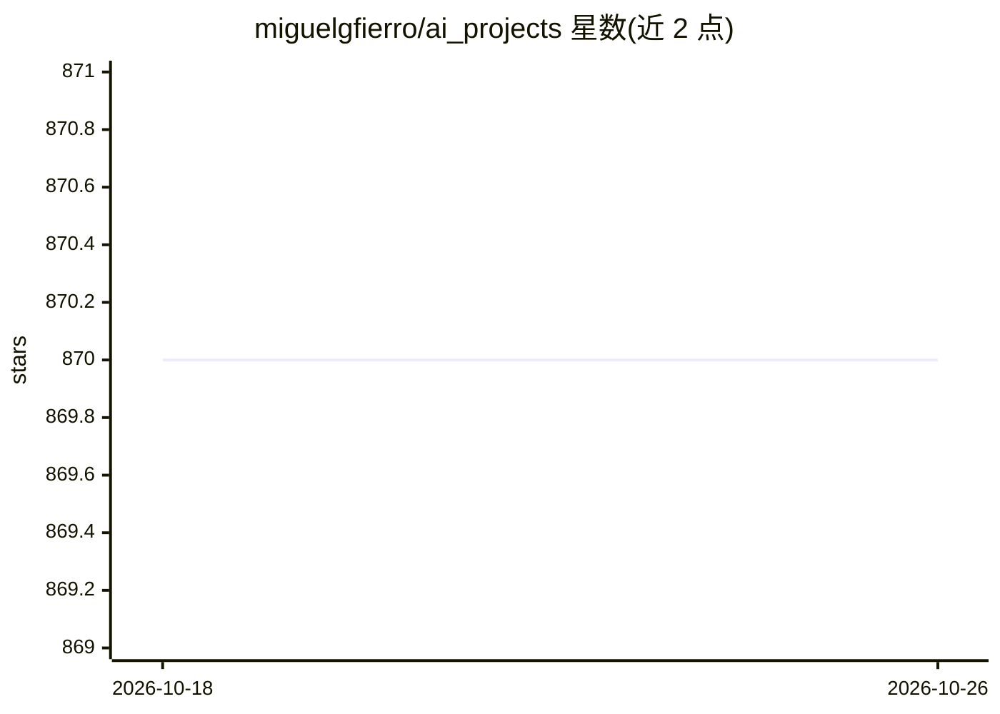

# miguelgfierro/ai_projects

⭐ 870 · Jupyter Notebook · NOASSERTION · 推送 2026-02-09 · [GitHub](https://github.com/miguelgfierro/ai_projects) · [官网](https://miguelgfierro.com/) · 个人维护

**多领域机器学习项目代码示例集合（附博客讲解）**

收录多个机器学习/深度学习项目的代码示例仓库，覆盖 CNN、迁移学习、文本分类、数据生成、t-SNE 降维、DeepSpeed 分布式训练、欺诈检测、推荐系统、fastText NLP、LSTM 股价预测与足球比赛可视化等，多数项目配有 sciblog 博客文章链接。面向学习机器学习实践的开发者，以 Jupyter notebook 形式提供示例，涉及 PyTorch、MXNet、CNTK、Keras、sklearn 等多种库。

## 筛选速览

| 维度 | 判定 | 备注 |
|---|---|---|
| AI 角色 | `ai-knowledge` | 知识聚合/清单类 |
| 许可风险 | `none` | NOASSERTION |
| 部署形态 | `None` |  |
| 模型依赖 | — | README 未给出锁定关系 |
| 硬件要求 | — | 无带数字的原话,不猜 |
| 安装摩擦 | `medium` | 含编译或系统依赖之一 |
| 成熟度 | — | 结构信号不足 |

## 能力要点

- 覆盖 CNN、迁移学习、分布式训练、欺诈检测、推荐系统等多个方向的项目示例
- 每个项目配有关联的博客文章讲解
- 示例使用 PyTorch、MXNet、CNTK、Keras、fastText 等多种框架

## 适用场景

- 学习 CNN、迁移学习等深度学习基础概念的实现方式
- 参考欺诈检测、推荐系统等端到端项目的代码结构
- 按博客文章配合代码练习机器学习应用开发

## 场景标签

`教程课程` · 领域:学习与行业

## 证据(README 行号)

> L11: This repo contains AI projects in multiple areas of machine learning. Many of these projects have associated articl
> L17: * Introduction to Convolutional Neural Networks: In this project we explain what is a convolution and how to comput

## 星数曲线

2026-10-18 870 → 2026-10-26 870（+0）

---
*卡片 v1 · prompt 1.4 · 生成 2026-10-21 · 置信度 high · 依据 README sha `a11ea9a2e707` · [字段定义](../../DATASET.md)*
