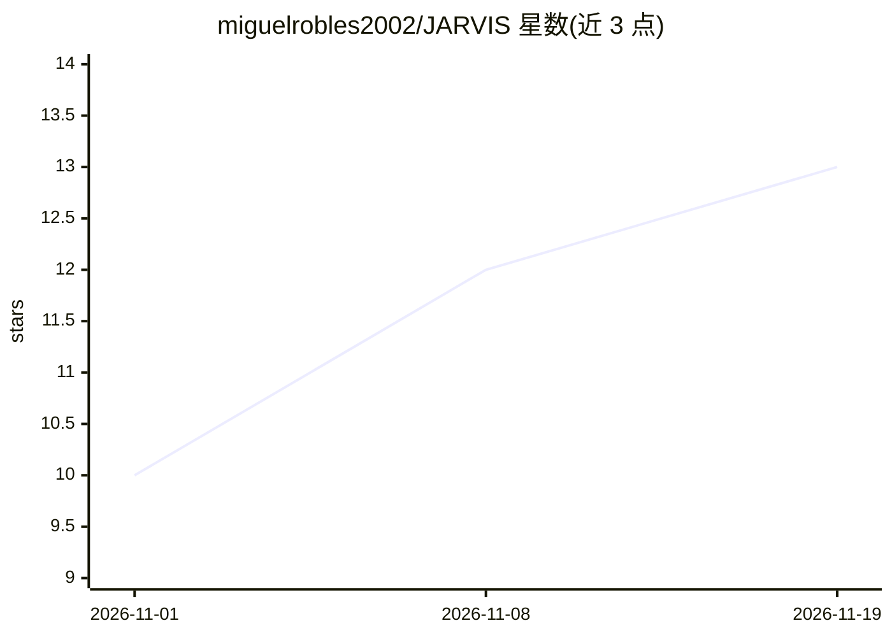

# miguelrobles2002/JARVIS

⭐ 13 · Python · 推送 2026-08-30 · [GitHub](https://github.com/miguelrobles2002/JARVIS) · 个人维护

**本地运行的语音+Telegram 个人 AI 助手，含 80+ 功能**

在本地 PC 运行的 Python 个人 AI 助手，通过语音和 Telegram 遥控，可在系统上执行实际操作而非仅对话。语音链路为 Whisper 识别 + Piper 合成，对话/视觉/图像生成依赖 Ollama、LLaVA、SDXL 等本地模型。提供裁剪后的公开版本：启动时以菜单完成配置（Telegram bot、模型选择、模块开关），用户数据存于 config.json；公开版不含 Kali/pentesting 模块。要求 Windows 10/11、Python 3.10+、Ollama。

## 筛选速览

| 维度 | 判定 | 备注 |
|---|---|---|
| AI 角色 | `ai-native` | 本体是模型或模型工具 |
| 许可风险 | `none` | — |
| 部署形态 | `None` |  |
| 模型依赖 | local-ok | 支持本地模型 |
| 硬件要求 | — | 无带数字的原话,不猜 |
| 安装摩擦 | `low` | 无编译、无系统依赖或容器化 |
| 成熟度 | — | 结构信号不足 |

## 能力要点

- 自然语言指令引擎，将语音/文本映射为 80+ 系统动作并处理优先级与冲突
- 语音识别（Whisper）与语音合成（Piper）完整本地语音链路
- Telegram 远程控制（34 个按钮）与 SSH 桥接到远程环境
- 对话、视觉、图像生成全部本地处理，不依赖云端服务

## 适用场景

- 在自己的 PC 上搭建不联网的个人语音助手
- 通过手机 Telegram 远程操控电脑执行操作
- 本地生成图像与图片理解

## 场景标签

`AI 助手` `语音 Agent` `图像生成` · 领域:对话与助手

## 证据(README 行号)

> L22: **JARVIS** es un asistente personal de IA que corre **en local** en mi propio PC,
> L35: 🧠  IA LOCAL            Conversación con Ollama · sin nube
> L45: Este repositorio incluye una **versión pública lista para usar** que puedes

## 星数曲线

2026-11-01 10 → 2026-11-19 13（+3）

---
*卡片 v1 · prompt 1.4 · 生成 2026-11-18 · 置信度 high · 依据 README sha `691a6d31e9be` · [字段定义](../../DATASET.md)*
