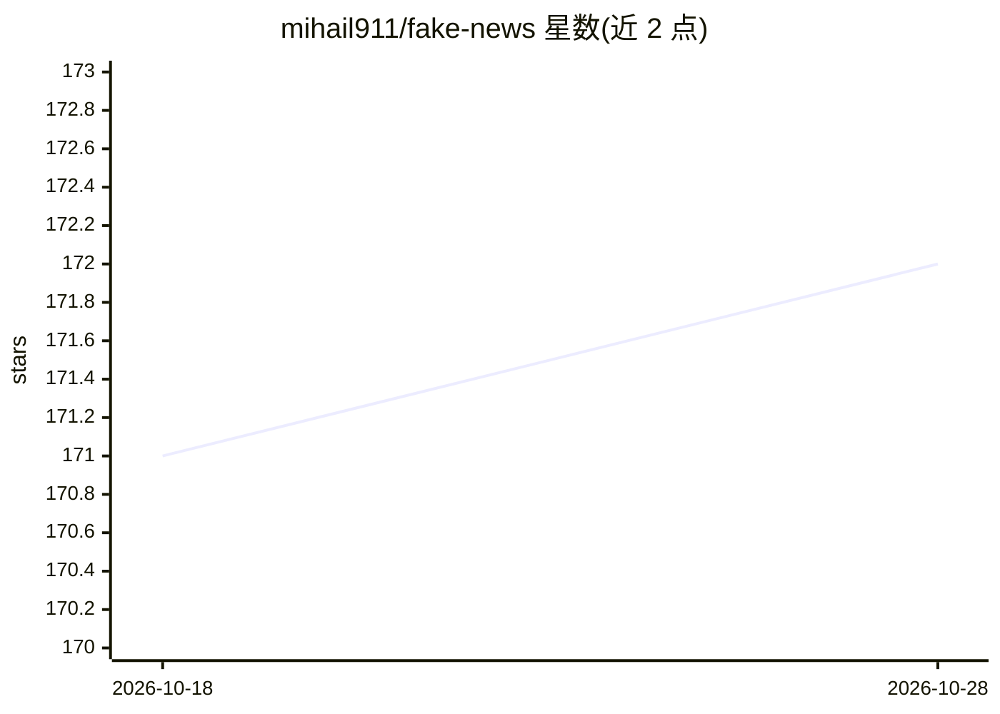

# mihail911/fake-news

⭐ 172 · Jupyter Notebook · AGPL-3.0 · 推送 2026-02-15 · [GitHub](https://github.com/mihail911/fake-news) · 个人维护

**端到端假新闻检测项目：从数据分析到模型训练与部署**

完整的机器学习示例仓库，配套博客系列讲解从项目搭建到部署全流程：用 Pandas 做探索性数据分析，DVC 做数据版本管理与可配置训练管线，先后实现基于 Scikit-learn 的随机森林基线和基于 HuggingFace Transformers + PyTorch Lightning 的 RoBERTa 模型；配合 MLFlow 实验跟踪、SHAP 特征与误差分析、GitHub Actions 持续集成，最终以 FastAPI + Gunicorn + Docker 提供 REST API，并附带 Chrome 扩展。限制：数据需按链接手动下载。

## 筛选速览

| 维度 | 判定 | 备注 |
|---|---|---|
| AI 角色 | `ai-native` | 本体是模型或模型工具 |
| 许可风险 | `viral` | AGPL-3.0 |
| 部署形态 | `self-host` | docker 或自建部署 |
| 模型依赖 | — | README 未给出锁定关系 |
| 硬件要求 | — | 无带数字的原话,不猜 |
| 安装摩擦 | `low` | 无编译、无系统依赖或容器化 |
| 成熟度 | — | 结构信号不足 |

## 能力要点

- 随机森林（Scikit-learn）与 RoBERTa（Transformers/PyTorch Lightning）两个模型版本
- DVC 数据版本管理与可配置训练/测试管线，MLFlow 实验跟踪
- FastAPI + Gunicorn + Docker 部署为 REST API，附 Chrome 扩展
- SHAP 特征分析、PyTest/Great Expectations 测试、GitHub Actions CI

## 适用场景

- 按博客系列学习端到端 ML 项目搭建流程
- 训练并部署假新闻文本检测 API
- 参考 MLOps 实践：数据版本化、实验跟踪与持续集成

## 场景标签

`MLOps` `教程课程` · 领域:学习与行业

## 证据(README 行号)

> L1: # Fake News Detector Powered By Machine Learning
> L19: * **Random forest classifier** powered by Scikit-learn.
> L20: * **RoBERTa** model powered by HuggingFace Transformers and PyTorch Lightning.

## 星数曲线

2026-10-18 171 → 2026-10-28 172（+1）

---
*卡片 v1 · prompt 1.4 · 生成 2026-10-22 · 置信度 high · 依据 README sha `fe8fec2123f4` · [字段定义](../../DATASET.md)*
