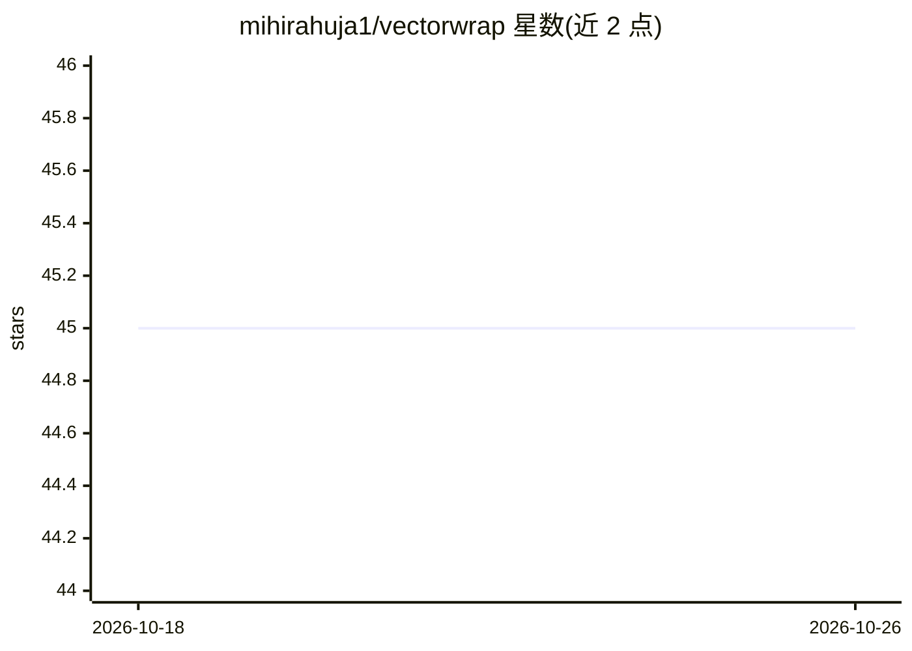

# mihirahuja1/vectorwrap

⭐ 45 · Python · MIT · 推送 2026-02-02 · [GitHub](https://github.com/mihirahuja1/vectorwrap) · [官网](https://pypi.org/project/vectorwrap/) · 个人维护

**多数据库向量检索统一封装库，一行代码切换后端**

Python 库，为 PostgreSQL/pgvector、MySQL HeatWave、MariaDB、SQLite/sqlite-vss、DuckDB、ClickHouse、Redis、RethinkDB 等后端提供统一的向量存取 API（VectorDB/create_collection/upsert/query），通过连接字符串切换后端，旧版 MySQL/MariaDB 自动回退 JSON 存储。核心 API 遵循语义版本化并承诺向后兼容。另提供 LangChain、LlamaIndex、Supabase、Milvus、Qdrant、Weaviate、Appwrite 等集成适配器，面向需要在多种数据库间迁移或混布向量检索的开发者。

## 筛选速览

| 维度 | 判定 | 备注 |
|---|---|---|
| AI 角色 | `ai-ecosystem` | LLM/agent 周边工具 |
| 许可风险 | `permissive` | MIT |
| 部署形态 | `library` | 以包/库形式分发 |
| 模型依赖 | — | README 未给出锁定关系 |
| 硬件要求 | — | 无带数字的原话,不猜 |
| 安装摩擦 | `low` | 无编译、无系统依赖或容器化 |
| 成熟度 | — | 结构信号不足 |

## 能力要点

- 一行连接字符串切换 9 种向量数据库后端
- 核心 API 遵循语义版本化，承诺向后兼容
- 旧版 MySQL/MariaDB 自动回退 JSON 存储与 Python 距离计算
- 提供 LangChain / LlamaIndex / Milvus / Qdrant / Weaviate 等集成包

## 适用场景

- 用 SQLite/DuckDB 原型验证后迁移到 PostgreSQL/ClickHouse 生产环境
- RAG 管线中作为可切换的 VectorStore 适配层
- 多租户场景为不同客户使用不同数据库后端

## 场景标签

`向量数据库` · 领域:知识与检索

## 证据(README 行号)

> L10: Universal vector search wrapper for Postgres, MySQL, SQLite, DuckDB, ClickHouse (pgvector, HeatWave, sqlite-vss, Du
> L183: - **LangChain**: Drop-in VectorStore adapter for RAG pipelines

## 星数曲线

2026-10-18 45 → 2026-10-26 45（+0）

---
*卡片 v1 · prompt 1.4 · 生成 2026-10-25 · 置信度 high · 依据 README sha `f2f6d4e0b5f2` · [字段定义](../../DATASET.md)*
