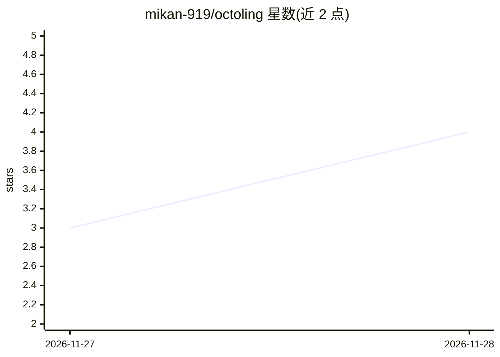

# mikan-919/octoling

⭐ 4 · Rust · MIT · 推送 2026-11-27 · [GitHub](https://github.com/mikan-919/octoling) · 个人维护

**在单张 NVIDIA RTX 50 GPU 上运行 Inkling-2 Mini 的推理引擎**

用 Rust 与 CUDA 编写的推理引擎，在单张 NVIDIA GPU 上加载 Thinking Machines Lab 的 Inkling-2 Mini 模型。支持读取官方 safetensors（NVFP4/MXFP8）与 Strata 量子化 SQ-10（约 10.5 GB，16 GB 显存可全部载入）两种权重格式，生成采用投机解码，草稿模型可用 Inco AI 的 DFlash2 或官方 DSpark。提供三种使用方式：终端单次问答、OpenAI 兼容 HTTP 服务器、速度基准测量。开发者声明仅在 RTX 5060 Ti 16 GB + WSL2 环境验证过。

## 筛选速览

| 维度 | 判定 | 备注 |
|---|---|---|
| AI 角色 | `ai-ecosystem` | LLM/agent 周边工具 |
| 许可风险 | `permissive` | MIT |
| 部署形态 | `None` |  |
| 模型依赖 | — | README 未给出锁定关系 |
| 硬件要求 | — | 无带数字的原话,不猜 |
| 安装摩擦 | `high` | 编译与系统依赖俱全 |
| 成熟度 | — | 结构信号不足 |

## 能力要点

- OpenAI 兼容 API（GET /v1/models、POST /v1/chat/completions）
- 读取 NVFP4/MXFP8 safetensors 与 SQ-10 .strata 量子化权重
- 投机解码，支持 DFlash2 与 DSpark 两种草稿模型
- 思考内容输出到 reasoning_content 字段，支持 reasoning_effort 参数

## 适用场景

- 在 16 GB 显存的单卡上本地运行 Inkling-2 Mini
- 给现有 OpenAI 客户端提供本地推理后端
- 测量投机解码与 prefill 的生成速度

## 场景标签

`推理引擎` · 领域:训练与推理

## 证据(README 行号)

> L7: Thinking Machines Lab の言語モデル Inkling-2 Mini の文章の部分を、NVIDIA の GPU 1枚で動かす推論エンジンです。Rust と CUDA で書いています。OpenAI 互換の HTTP 
> L9: 重みは2つの形式を読めます。1つは公式の safetensors（NVFP4 と MXFP8）、もう1つは Strata が配布する量子化済みの SQ-10（`.strata`、約 10.5 GB）です。16 GB の GPU では

## 星数曲线

2026-11-27 3 → 2026-11-28 4（+1）

---
*卡片 v1 · prompt 1.4 · 生成 2026-11-27 · 置信度 high · 依据 README sha `f0dcf0a23bda` · [字段定义](../../DATASET.md)*
