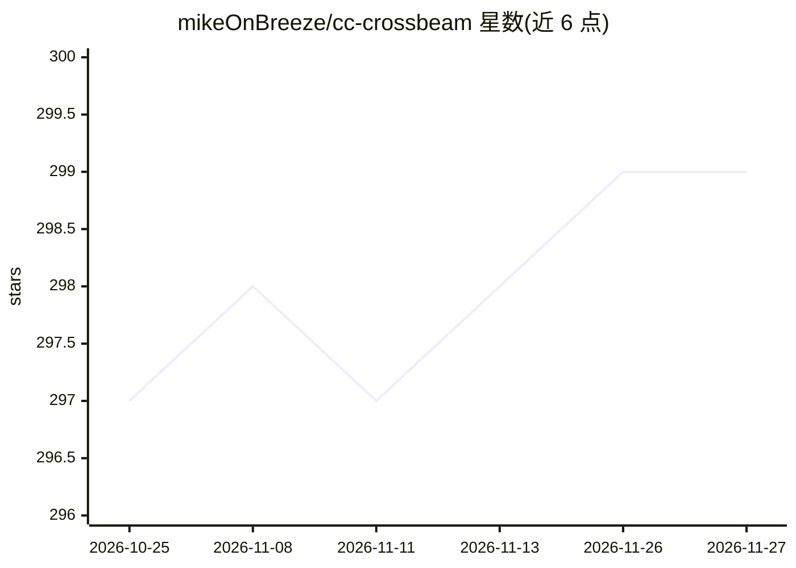

# mikeOnBreeze/cc-crossbeam

⭐ 299 · Python · MIT · 推送 2026-10-30 · [GitHub](https://github.com/mikeOnBreeze/cc-crossbeam) · [官网](https://www.crossbeam-permits.com) · 个人维护

**面向城市与建造方的 AI 建筑许可图纸审查系统**

为城市、县政府与政府机构以及建造方提供 AI 图纸审查：申请方工具在提交前预检图纸，内部工具处理收件筛查、建筑与规划审查、更正函与回查。AI agent 读取建筑图纸（视觉解析 PDF）、解读城市更正函、交叉引用加州 ADU 法律并经网络检索地方市政法规，生成可重新提交的答复包；领域知识以 28+ 个 skills 结构化参考文件组织。本仓库为 2026 年 2 月 Claude Code 黑客松快照，非当前产品；本地运行需 Node.js 20+、Supabase、Anthropic API key 与 Vercel 账户。

## 筛选速览

| 维度 | 判定 | 备注 |
|---|---|---|
| AI 角色 | `ai-native` | 本体是模型或模型工具 |
| 许可风险 | `permissive` | MIT |
| 部署形态 | `library` | 以包/库形式分发 |
| 模型依赖 | locked-api |  |
| 硬件要求 | — | 无带数字的原话,不猜 |
| 安装摩擦 | `low` | 无编译、无系统依赖或容器化 |
| 成熟度 | `idea` | |

## 能力要点

- 三个流程：更正函解读、许可清单生成、城市预筛（黑客松版仅路线图）
- skills-first 设计：28+ 参考文件覆盖 HCD 手册与政府代码及决策树路由
- 架构：Next.js 前端 + Cloud Run 编排器 + Vercel Sandbox + Supabase Realtime
- agent 运行 10-30 分钟，Cloud Run 提供持久编排进程

## 适用场景

- 承包商针对城市更正函生成重新提交的答复包
- 提交前根据州与地方代码预检图纸
- 生成包含城市特定要求的预提交清单

## 场景标签

`文档解析` · 领域:知识与检索

## 证据(README 行号)

> L37: An AI agent reads the architectural plans, interprets the city's corrections letter, cross-references California st
> L90: |Agent|Agent SDK, `claude_code` preset|

## 星数曲线

2026-10-25 297 → 2026-11-27 299（+2）

---
*卡片 v1 · prompt 1.4 · 生成 2026-11-25 · 置信度 high · 依据 README sha `01f53cc6b1c1` · [字段定义](../../DATASET.md)*
