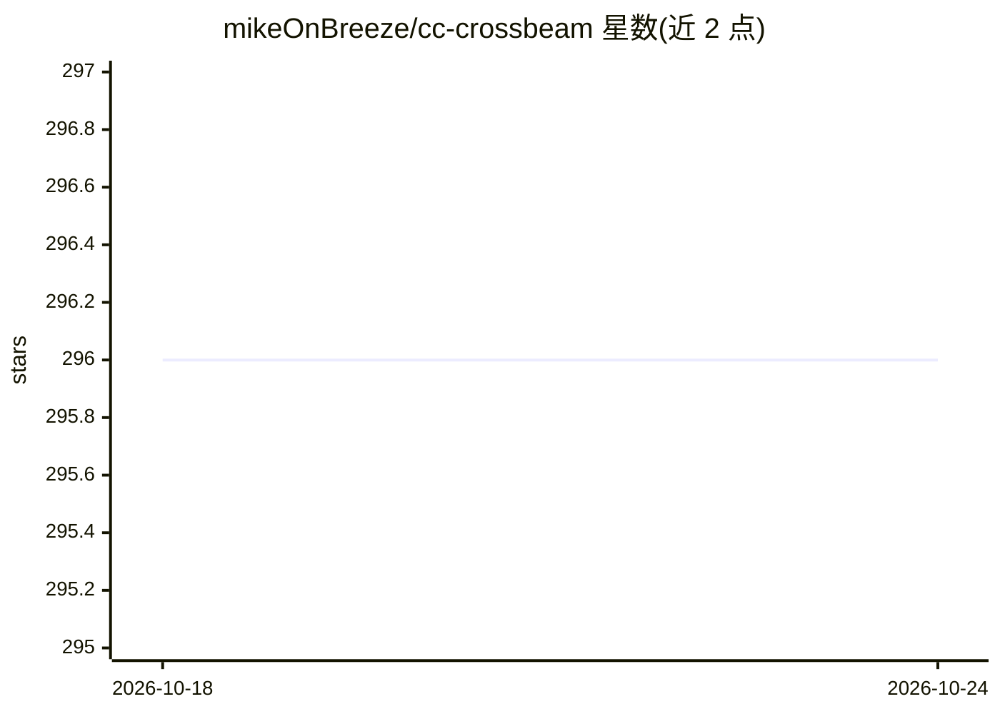

# mikeOnBreeze/cc-crossbeam

⭐ 297 · Python · MIT · 推送 2026-03-02 · [GitHub](https://github.com/mikeOnBreeze/cc-crossbeam) · [官网](https://www.crossbeam-permits.com) · 个人维护

**面向加州 ADU 许可的 AI 审图助手：读图纸、解读整改函、生成答复包**

面向承包商与业主的建筑许可工具：以 Claude Opus 4.6 为 agent，读取上传的建筑图纸 PDF（视觉逐页提取），解析城市整改函逐项条款，交叉比对加州 ADU 法（Government Code 66310-66342）与市级法规（实时网络检索），生成分析报告、工程范围说明与答复信草稿；另提供按城市生成预提交清单的流程。技术栈为 Next.js 前端 + Cloud Run/Express 编排 + Supabase，领域知识以 28+ 个 skill 参考文件形式注入。为 2026 年 Claude Code 黑客松获奖项目；城市端预审流程仅为路线图，未实现。

## 筛选速览

| 维度 | 判定 | 备注 |
|---|---|---|
| AI 角色 | `ai-native` | 本体是模型或模型工具 |
| 许可风险 | `permissive` | MIT |
| 部署形态 | `library` | 以包/库形式分发 |
| 模型依赖 | locked-api |  |
| 硬件要求 | — | 无带数字的原话,不猜 |
| 安装摩擦 | `low` | 无编译、无系统依赖或容器化 |
| 成熟度 | — | 结构信号不足 |

## 能力要点

- 视觉逐页读取建筑图纸并解析城市整改函逐项条款
- 交叉引用加州 ADU 法与市级法规（实时网络检索）生成答复包
- 领域知识以 28+ 个 skill 参考文件与决策树路由注入 agent
- 三种流程：整改函解读、许可清单生成、城市预审（后者为未实现的路线图）

## 适用场景

- 承包商收到城市整改函后生成专业答复包重新提交
- 提交前按城市具体要求生成预提交清单
- 查阅项目构建过程（progress.md 含语音记录）

## 场景标签

`文档问答` `AI 写作` · 领域:内容生成

## 证据(README 行号)

> L7: AI-powered ADU permit assistant for California. Upload your architectural plans and corrections letter — get back a 
> L25: CrossBeam uses Claude Opus 4.6 as an AI agent that reads your architectural plans, interprets city corrections lett
> L47: A city building department uploads a permit submission. The agent reviews it against their own requirements and sta

## 星数曲线

2026-10-18 296 → 2026-10-24 296（+0）

---
*卡片 v1 · prompt 1.4 · 生成 2026-10-21 · 置信度 high · 依据 README sha `75dc57453901` · [字段定义](../../DATASET.md)*
