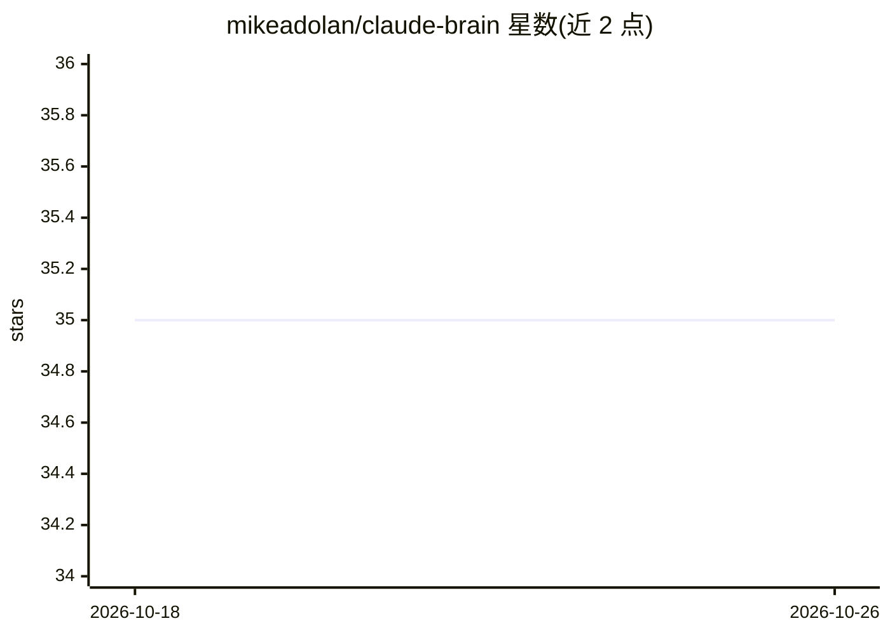

# mikeadolan/claude-brain

⭐ 35 · Python · MIT · 推送 2026-05-27 · [GitHub](https://github.com/mikeadolan/claude-brain) · 个人维护

**给 Claude Code 用户的本地持久记忆层：SQLite 全量留存对话**

面向 Claude Code 使用者的持久记忆工具：通过 hooks 自动捕获每条对话到本地 SQLite 数据库，实现跨项目的关键词/语义/模糊三种检索，并经 MCP 注册 11 个只读工具供 Claude 查询决策、事实与转录。支持从 Claude.ai、ChatGPT、Gemini 导入历史会话并按来源打标；另提供每日站会、每周摘要等邮件摘要模板，可配合 Dropbox 等云盘做多机同步（数据库本身保留本地）。要求 Python 3.10+ 与 Claude Code 2.0+，提供一键安装脚本与手动安装两种方式，全部数据不离开本机。

## 筛选速览

| 维度 | 判定 | 备注 |
|---|---|---|
| AI 角色 | `ai-ecosystem` | LLM/agent 周边工具 |
| 许可风险 | `permissive` | MIT |
| 部署形态 | `library` | 以包/库形式分发 |
| 模型依赖 | — | README 未给出锁定关系 |
| 硬件要求 | — | 无带数字的原话,不猜 |
| 安装摩擦 | `low` | 无编译、无系统依赖或容器化 |
| 成熟度 | — | 结构信号不足 |

## 能力要点

- hooks 自动捕获全量对话到本地 SQLite，保留原文不做摘要
- 关键词/语义/模糊三种跨项目检索
- 11 个只读 MCP 工具（brain-server）供 Claude 查询
- 可导入 Claude.ai / ChatGPT / Gemini 历史会话并按来源打标

## 适用场景

- 跨项目查找过去会话中的决策与讨论
- 每天通过邮件摘要了解各项目进展与阻塞
- 把多个 AI 平台的历史对话集中到本地统一检索

## 场景标签

`Agent 记忆` `语义搜索` · 领域:Agent 开发

## 证据(README 行号)

> L7: **Introducing claude-brain for Claude Code - Your AI finally has a real memory.** Not just RAG, RAG and beyond. 100%
> L30: |**RAG (context injection)**|Every prompt gets relevant memories injected automatically - hooks search your history
> L212: Eleven read-only tools registered as `brain-server`. Claude calls these automatically - you just ask questions.

## 星数曲线

2026-10-18 35 → 2026-10-26 35（+0）

---
*卡片 v1 · prompt 1.4 · 生成 2026-10-25 · 置信度 mid · 依据 README sha `18489bf46962` · [字段定义](../../DATASET.md)*
