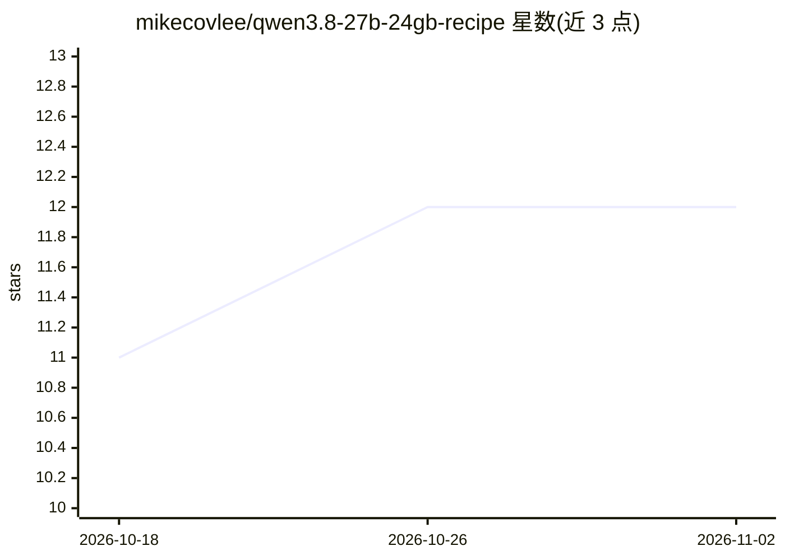

# mikecovlee/qwen3.8-27b-24gb-recipe

⭐ 12 · PowerShell · MIT · 推送 2026-10-14 · [GitHub](https://github.com/mikecovlee/qwen3.8-27b-24gb-recipe) · 个人维护 · 中文 README

**单张 24GB GPU 上本地运行 Qwen3.8-27B 的 llama.cpp 配置方案**

提供两套开箱即用的部署配方，在单张 24GB NVIDIA GPU 上以 llama.cpp（b11491, CUDA 13.4）本地服务 Qwen3.8-27B：Recipe 1 为 IQ3_S 量化（含 GPU 视觉 mmproj），Recipe 2 为 unsloth UD-Q4_K_XL。两者均支持 256K 原生上下文（q4_0 KV）、MTP 投机解码，并暴露 OpenAI 兼容 API（端口 8080）。每套配方附 PowerShell 安装、启动、验证与基准脚本，下载可断点续传。限制：同一时间仅一套配方运行，--parallel 1 串行处理请求；要求 32GB 以上内存、Windows 10/11 与 CUDA 13.x 构建。附 RTX A5000 上的 prefill/decode 基准数据与故障排查条目。

## 筛选速览

| 维度 | 判定 | 备注 |
|---|---|---|
| AI 角色 | `ai-ecosystem` | LLM/agent 周边工具 |
| 许可风险 | `permissive` | MIT |
| 部署形态 | `None` |  |
| 模型依赖 | local-ok | 支持本地模型 |
| 硬件要求 | `gpu-8g` | |
| 安装摩擦 | `medium` | 含编译或系统依赖之一 |
| 成熟度 | — | 结构信号不足 |

## 能力要点

- 两套量化配方（IQ3_S 含视觉 / UD-Q4_K_XL）共享同一引擎与 OpenAI 兼容 API
- 256K 原生上下文，无需 rope 缩放，q4_0 KV 缓存
- MTP 投机解码（--spec-type draft-mtp，draft-n-max 3 默认最优）
- 附安装/启动/验证/基准 PowerShell 脚本，下载可续传、带尺寸校验

## 适用场景

- 在 RTX 3090/4090/A5000 等 24GB 显卡上本地跑 256K 长上下文模型
- 需要视觉（图像理解）能力的本地 Qwen3.8-27B 服务
- 通过 OpenAI 兼容 API 接入 opencode 等客户端做编辑器集成

## 场景标签

`推理引擎` · 领域:训练与推理

## 证据(README 行号)

> L3: A ready-to-run setup for serving **Qwen3.8-27B** locally on a single **24 GB NVIDIA GPU** with llama.cpp. Two recipe
> L13: - **OpenAI-compatible API** — works with opencode and any OpenAI-compatible client.

## 星数曲线

2026-10-18 11 → 2026-11-02 12（+1）

---
*卡片 v1 · prompt 1.4 · 生成 2026-11-01 · 置信度 high · 依据 README sha `8d727d456319` · [字段定义](../../DATASET.md)*
