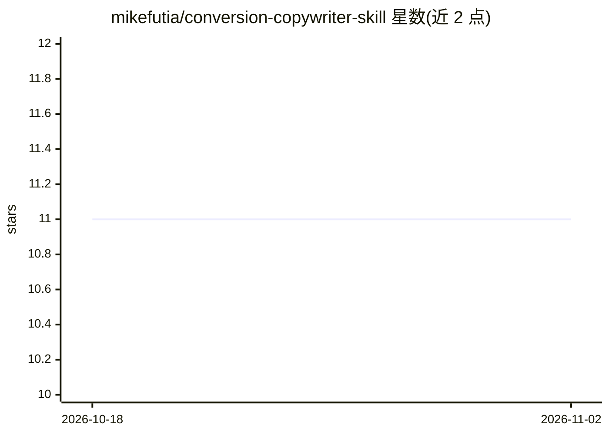

# mikefutia/conversion-copywriter-skill

⭐ 11 · HTML · NOASSERTION · 推送 2026-07-22 · [GitHub](https://github.com/mikefutia/conversion-copywriter-skill) · 个人维护

**Claude Code 写作技能：按三规则生成转化文案（落地页/邮件/FB广告）**

面向营销文案写作者的 Claude Code 技能包：基于 Harry Dry 的三条文案规则（可视觉化/可证伪/不可复制），在用户提供背景、评论与事实后，先生成多版候选句并按规则打分过滤，最终输出 HTML 文案卡组到 ./copy-run/ 目录。流程包含需求采集、事实挖掘、抽象追问、冲突定位与逐句门控评分；声明不编造具体事实，缺少事实时会绕开或向用户追问。安装方式为将文件夹放入 ~/.claude/skills/，渲染器仅用 Python 3 标准库。

## 筛选速览

| 维度 | 判定 | 备注 |
|---|---|---|
| AI 角色 | `ai-native` | 本体是模型或模型工具 |
| 许可风险 | `none` | NOASSERTION |
| 部署形态 | `None` |  |
| 模型依赖 | locked-api |  |
| 硬件要求 | — | 无带数字的原话,不猜 |
| 安装摩擦 | `low` | 无编译、无系统依赖或容器化 |
| 成熟度 | — | 结构信号不足 |

## 能力要点

- 三条规则门控每条关键句，低于 2 分退回重写
- 每条关键句生成 4-6 个版本并逐句打分
- 输出 brief.json/copy.json/copy-deck.html 到本地目录
- 声明不发明具体事实，事实缺失时绕开或追问

## 适用场景

- 在 Claude Code 中生成落地页、邮件或长图文 Facebook 广告文案
- 基于真实评论与产品事实改写模糊抽象的营销文案
- 查看带评分与备选句的文案卡组用于人工挑选

## 场景标签

`AI 写作` · 领域:内容生成

## 证据(README 行号)

> L3: A Claude Code skill that **writes** conversion copy — long-form Facebook ads, emails, and landing pages.
> L41: 1. **Intake** — format, what it is, where the reader's head is now (Point A), where you need them to land (Point B)
> L45: 5. **Writes hot and ugly** — 4–6 versions of every load-bearing line, bad ones included on purpose, because the dir

## 星数曲线

2026-10-18 11 → 2026-11-02 11（+0）

---
*卡片 v1 · prompt 1.4 · 生成 2026-11-02 · 置信度 high · 依据 README sha `ab7b9ef5c5f3` · [字段定义](../../DATASET.md)*
