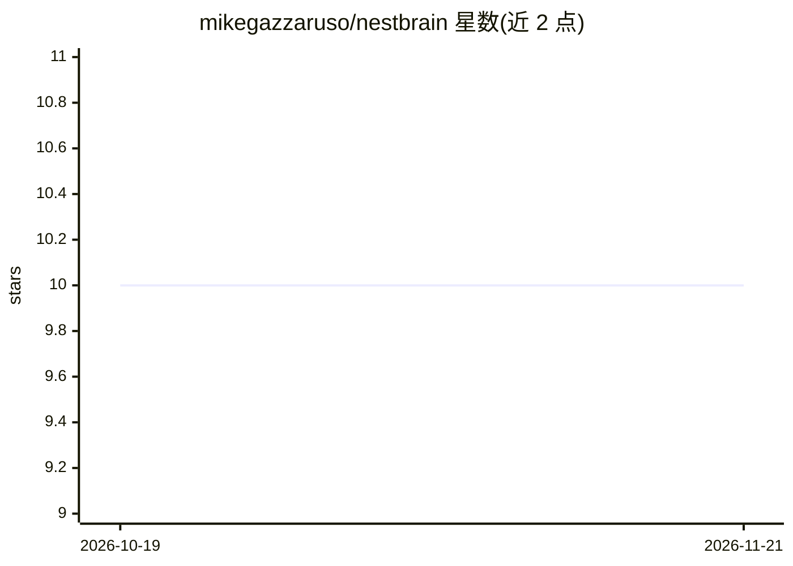

# mikegazzaruso/nestbrain

⭐ 10 · TypeScript · GPL-3.0 · 推送 2026-07-03 · [GitHub](https://github.com/mikegazzaruso/nestbrain) · [官网](https://nestbrain.app) · 组织维护

**为开发者用 LLM 将原始资料编译成互联 Markdown 知识库的工作台**

NestBrain 是一个本地运行的集成工作台：摄入网页、PDF、GitHub 仓库、arXiv 论文、YouTube 字幕、RSS 等来源，用 LLM 将其编译为带反向链接与引用的 Markdown wiki，兼容 Obsidian；内置 VS Code 风格文件树、CodeMirror 6 编辑器、PTY 终端与源码管理面板。通过 Claude Code 提供 session-aware 助手（start/end_session 技能、STATE.md 上下文交接），混合检索（本地嵌入 all-MiniLM-L6-v2 + 关键词）支持带引用的自然语言问答与思维导图。GPL-3.0 可源码构建，签名二进制一次性 $29，另有企业版团队知识共享。

## 筛选速览

| 维度 | 判定 | 备注 |
|---|---|---|
| AI 角色 | `ai-native` | 本体是模型或模型工具 |
| 许可风险 | `viral` | GPL-3.0 |
| 部署形态 | `desktop` | 安装包/桌面程序 |
| 模型依赖 | locked-api |  |
| 硬件要求 | — | 无带数字的原话,不猜 |
| 安装摩擦 | `low` | 无编译、无系统依赖或容器化 |
| 成熟度 | — | 结构信号不足 |

## 能力要点

- LLM 将多来源资料增量编译为互联 Markdown wiki（每来源约 3-5 次调用）
- Claude Code 深度集成：CLAUDE.md、Skills 目录与 STATE.md 跨会话上下文交接
- 混合检索问答带引用，答案自动写回 wiki
- git post-commit 钩子自动抽取知识原子，经人工审核队列入库

## 适用场景

- 把散落的论文、网页、仓库沉淀成结构化个人知识库
- 用自然语言向自己的知识库提问并获得带引用的回答
- 让 Claude Code 跨会话记住项目进展并续接工作
- 团队在自托管服务器上共享编译后的知识库

## 场景标签

`知识库管理` `文档问答` · 领域:知识与检索

## 证据(README 行号)

> L3: **Your AI-powered second brain, packaged as a native workspace for people who actually build things.** Raw sources g
> L31: NestBrain ingests raw documents — web pages, PDFs, GitHub repos, arXiv papers, YouTube transcripts, RSS feeds — and
> L103: - **Hybrid search** — semantic (local embeddings via all-MiniLM-L6-v2) + keyword, normalized and weighted

## 星数曲线

2026-10-19 10 → 2026-11-21 10（+0）

---
*卡片 v1 · prompt 1.4 · 生成 2026-11-19 · 置信度 mid · 依据 README sha `5de29ed61d83` · [字段定义](../../DATASET.md)*
