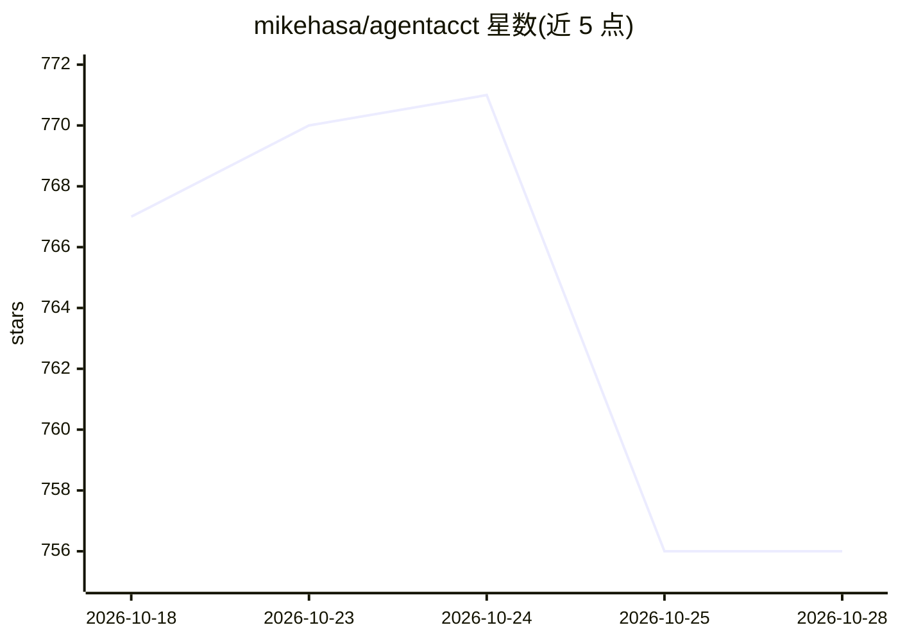

# mikehasa/agentacct

⭐ 756 · Python · MIT · 推送 2026-10-03 · [GitHub](https://github.com/mikehasa/agentacct) · [官网](https://trytofu.ai) · 个人维护

**本地优先的编码 Agent 工作记录与用量成本看板**

读取 Claude Code、Codex、Kimi Code、OpenCode、Hermes 等编码 Agent 的本地会话日志，生成任务 Work Receipt：参与的会话、记录的结果、token 与按价目表估算的成本、检查结果与活动时间线。两条证据流（客户端报告的用量、经 MCP 记录的工作步骤与检查）按真实会话 ID 关联并标注置信度。提供 TUI 与 macOS 应用，仅监听 127.0.0.1，无账号与遥测。自称 early alpha，各 Agent 支持程度按能力矩阵区分。

## 筛选速览

| 维度 | 判定 | 备注 |
|---|---|---|
| AI 角色 | `ai-ecosystem` | LLM/agent 周边工具 |
| 许可风险 | `permissive` | MIT |
| 部署形态 | `library` | 以包/库形式分发 |
| 模型依赖 | — | README 未给出锁定关系 |
| 硬件要求 | — | 无带数字的原话,不猜 |
| 安装摩擦 | `low` | 无编译、无系统依赖或容器化 |
| 成熟度 | `idea` | |

## 能力要点

- 从本地会话日志聚合 token、成本估算与工作步骤，生成任务 Work Receipt
- 区分 Reported 与 Verified：验证需最后一次改动后有通过的检查
- 用量与记录工作按真实客户端 ID 关联，每次关联标注 exact/high/medium/low 置信度
- 不记录提示词、模型回复或转录，仅监听 127.0.0.1，不请求 API key

## 适用场景

- 查看我各项目里编码 Agent 做了什么、花了多少 token 和钱
- 区分 Agent 自称完成与检查通过验证的结果
- 跨 Agent 汇总某个项目文件夹上的工作与用量

## 场景标签

`LLM 可观测性` · 领域:评测与运维

## 证据(README 行号)

> L12: See what your coding agents have been working on, across projects and clients: recent activity, tool calls, recorde
> L77: agentacct is local-first Agent Work Intelligence: two evidence streams, kept separate and joined on real client ids
> L80: - **What it did** comes from the steps and checks the agent records over MCP as it works, plus machine checks such 

## 星数曲线

2026-10-18 767 → 2026-10-28 756（-11）

---
*卡片 v1 · prompt 1.4 · 生成 2026-10-22 · 置信度 high · 依据 README sha `42d81061eefb` · [字段定义](../../DATASET.md)*
