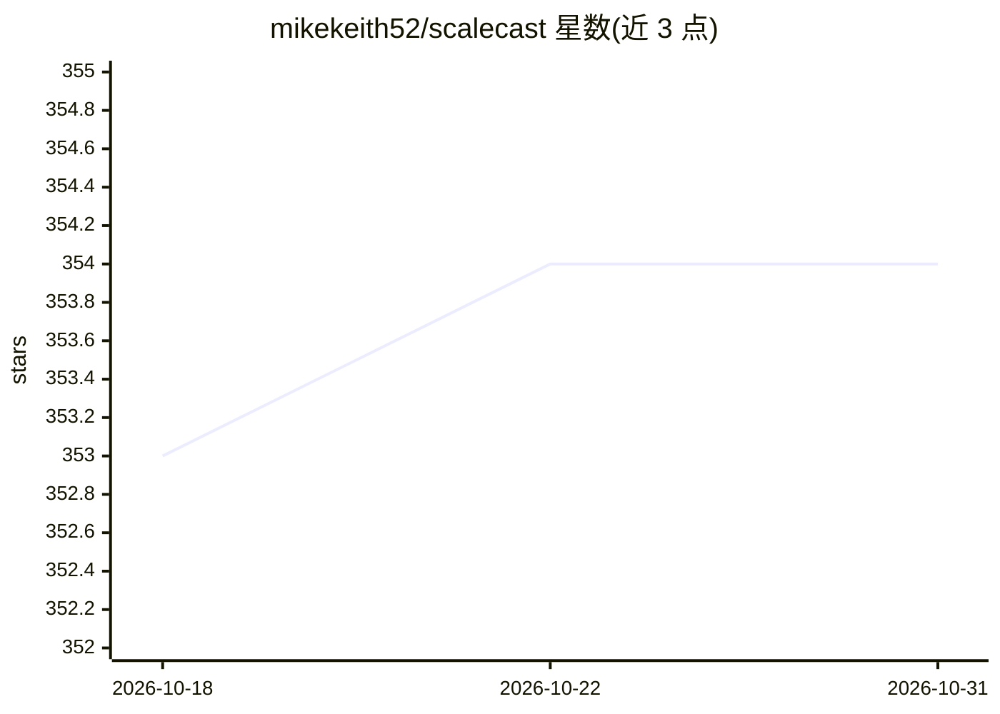

# mikekeith52/scalecast

⭐ 354 · Python · MIT · 推送 2026-10-12 · [GitHub](https://github.com/mikekeith52/scalecast) · 个人维护

**Python 时间序列预测库：统一接口建模、调参与可视化**

面向实践者的时间序列预测库，通过 Forecaster 与 MVForecaster 对象统一接入 scikit-learn、statsmodels、tensorflow 等多来源模型，覆盖 LSTM 建模、滞后/趋势/季节性自动选择、网格搜索与时间序列交叉验证、变换与回测流水线、模型堆叠、多变量建模与迁移学习，并内置绘图与置信区间功能。适用含缺失值、需动态变换的序列，以及概念验证实验与学术研究。基础包 pip 安装即可使用，可选依赖包括 tensorflow、prophet、lightgbm 等。

## 筛选速览

| 维度 | 判定 | 备注 |
|---|---|---|
| AI 角色 | `ai-native` | 本体是模型或模型工具 |
| 许可风险 | `permissive` | MIT |
| 部署形态 | `library` | 以包/库形式分发 |
| 模型依赖 | — | README 未给出锁定关系 |
| 硬件要求 | — | 无带数字的原话,不猜 |
| 安装摩擦 | `low` | 无编译、无系统依赖或容器化 |
| 成熟度 | — | 结构信号不足 |

## 能力要点

- Forecaster/MVForecaster 统一接口接入 scikit-learn、statsmodels、tensorflow 等模型
- 自动滞后/趋势/季节性选择与网格搜索+时间序列交叉验证调参
- 含变换、还原与回测的流水线，支持模型堆叠与迁移学习
- 共形置信区间与结果可视化绘图

## 适用场景

- 对含缺失值或需动态变换的序列做预测
- 快速搭建时间序列概念验证实验并做模型验证
- 学术研究中复用统一接口比较多种预测模型

## 场景标签

`数据分析` `科研工具` · 领域:效率与自动化

## 证据(README 行号)

> L7: Scalecast helps you forecast time series. It is especially good in the following use cases:
> L23: Uniform ML modeling (with models from a diverse set of libraries, including scikit-learn, statsmodels, and tensorfl

## 星数曲线

2026-10-18 353 → 2026-10-31 354（+1）

---
*卡片 v1 · prompt 1.4 · 生成 2026-10-21 · 置信度 high · 依据 README sha `a41ba60da0e7` · [字段定义](../../DATASET.md)*
