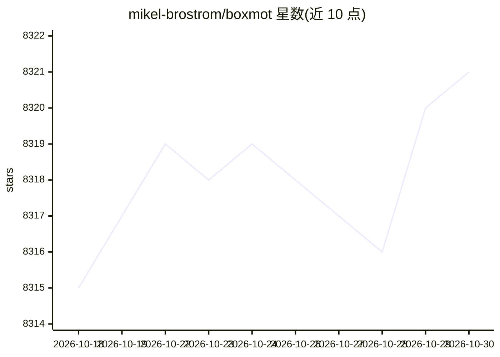

# mikel-brostrom/boxmot

⭐ 8,321 · Python · AGPL-3.0 · 推送 2026-10-27 · [GitHub](https://github.com/mikel-brostrom/boxmot) · [官网](https://mikel-brostrom.github.io/boxmot/) · 个人维护

**可插拔多目标跟踪模块库，供开发者对任意检测器输出做跟踪**

BoxMOT 提供基于 Torch 结构的检测器、分割器、外观编码器与跟踪器独立组件，组件可组合成流水线，支持轴对齐（AABB）与旋转边界框（OBB）跟踪。CLI 覆盖 track/eval/tune/research/train-reid/export 等工作流，内置 botsort、bytetrack、ocsort、deepocsort 等 9 种跟踪器并给出 MOT17/SportsMOT/MMOT 基准结果。提供可选的 C++ 原生跟踪器后端（--tracker-backend cpp，可经 CMake 嵌入独立 C++ 项目）。Python 3.10-3.13 支持，pip 安装。

## 筛选速览

| 维度 | 判定 | 备注 |
|---|---|---|
| AI 角色 | `ai-native` | 本体是模型或模型工具 |
| 许可风险 | `viral` | AGPL-3.0 |
| 部署形态 | `library` | 以包/库形式分发 |
| 模型依赖 | — | README 未给出锁定关系 |
| 硬件要求 | — | 无带数字的原话,不猜 |
| 安装摩擦 | `medium` | 含编译或系统依赖之一 |
| 成熟度 | — | 结构信号不足 |

## 能力要点

- 独立可替换的检测/分割/外观编码/跟踪组件，支持 AABB 与 OBB 跟踪
- 单一 CLI 覆盖 track/eval/tune/research/train-reid/export 等工作流
- 9 种跟踪器含 MOT17/SportsMOT/MMOT 基准分数（Python 与 C++ 双路径）
- 可选 C++ 原生跟踪器后端，可经 CMake 嵌入独立 C++ 项目

## 适用场景

- 对视频流中的任意检测器输出做多目标跟踪与评测
- 对比不同跟踪器在 MOT17/SportsMOT 等数据集上的表现
- 在 C++ 项目中嵌入与 Python 路径指标一致的跟踪器

## 场景标签

`目标检测` · 领域:感知与多模态

## 证据(README 行号)

> L5:  Pluggable Python and C++ multi-object tracking modules for axis-aligned and oriented bounding box detections from a
> L26: BoxMOT provides independent detector, segmentor, appearance-encoder, and tracker
> L27: components built around validated Torch structures. Pipelines compose those

## 星数曲线

2026-10-18 8,315 → 2026-10-30 8,321（+6）

---
*卡片 v1 · prompt 1.4 · 生成 2026-10-20 · 置信度 high · 依据 README sha `85d29f7571cf` · [字段定义](../../DATASET.md)*
