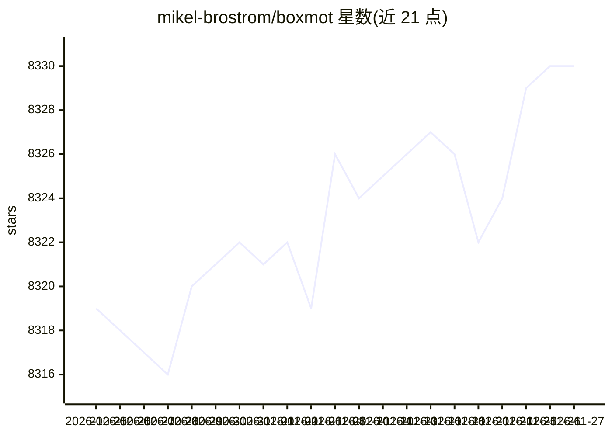

# mikel-brostrom/boxmot

⭐ 8,330 · Python · NOASSERTION · 推送 2026-11-20 · [GitHub](https://github.com/mikel-brostrom/boxmot) · [官网](https://mikel-brostrom.github.io/boxmot/) · 个人维护

**多目标跟踪模块库：为检测框提供可插拔的跟踪与评估**

BoxMOT 提供相互独立的检测器、分割器、外观编码器与跟踪器组件，可组合成跟踪流水线；CLI 覆盖 track、eval、tune、数据物化、ReID 训练评估等模式。支持轴对齐框（AABB）与旋转框（OBB）两类跟踪路径，内置 botsort、bytetrack、ocsort、boosttrack 等多种跟踪器并给出 MOT17、SportsMOT、MMOT 基准数值，可选 C++ 后端经 CMake 嵌入独立项目。要求 Python 3.10–3.13，属性标注功能依赖 PostgreSQL 与 VLM 服务。

## 筛选速览

| 维度 | 判定 | 备注 |
|---|---|---|
| AI 角色 | `ai-native` | 本体是模型或模型工具 |
| 许可风险 | `none` | NOASSERTION |
| 部署形态 | `library` | 以包/库形式分发 |
| 模型依赖 | local-ok | 支持本地模型 |
| 硬件要求 | — | 无带数字的原话,不猜 |
| 安装摩擦 | `high` | 编译与系统依赖俱全 |
| 成熟度 | — | 结构信号不足 |

## 能力要点

- 多种跟踪器（occluboost/botsort/bytetrack/ocsort 等）可插拔替换
- 支持 AABB 与 OBB 两种跟踪路径
- 提供 CLI、终端 UI 与结构化 Python API 三种使用方式
- 可选 C++ 跟踪后端，可通过 CMake 嵌入独立 C++ 项目

## 适用场景

- 给 YOLO 检测输出加上跨帧目标 ID 跟踪
- 在 MOT17 等数据集上评估与调优跟踪器
- 在 Kubernetes 上对接网络摄像头做持续跟踪
- 为行人跟踪轨迹附加衣着姿态属性描述

## 场景标签

`目标检测` · 领域:感知与多模态

## 证据(README 行号)

> L5:  Pluggable Python and C++ multi-object tracking modules for axis-aligned and oriented bounding box detections from a
> L26: BoxMOT provides independent detector, segmentor, appearance-encoder, and tracker

## 星数曲线

2026-10-25 8,319 → 2026-11-27 8,330（+11）

---
*卡片 v1 · prompt 1.4 · 生成 2026-11-22 · 置信度 high · 依据 README sha `d31fd8157227` · [字段定义](../../DATASET.md)*
