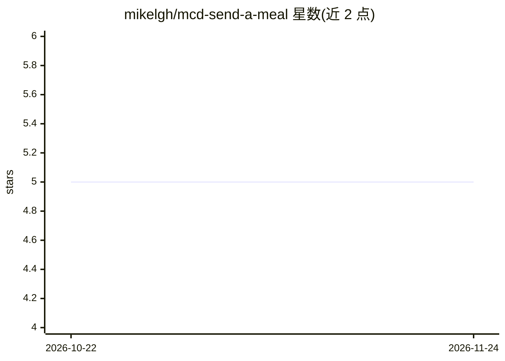

# mikelgh/mcd-send-a-meal

⭐ — · [GitHub]() · 个人维护 · 中文 README

**用麦当劳中国 MCP 给异地的爸妈/恋人/同事代点一份麦当劳**

基于麦当劳中国官方 MCP Server 的异地代送 CLI 与 Agent Skill：按收件人地址查找可配送门店、拉取该店在售菜单、按收件人画像（控钠/控卡/高蛋白等）做本地确定性营养约束求解，重查门店券并调官方 calculate-price 核价，写操作需显式 --confirm 门控。零第三方依赖，仅 Python 标准库，提供 --dry-run 离线演示（无需 Token）与 WorkBuddy Skill 形态。仅支持麦当劳中国渠道，真实使用需自行激活 MCP Token。

## 筛选速览

| 维度 | 判定 | 备注 |
|---|---|---|
| AI 角色 | `ai-native` | 本体是模型或模型工具 |
| 许可风险 | `permissive` | — |
| 部署形态 | `None` |  |
| 模型依赖 | — | README 未给出锁定关系 |
| 硬件要求 | — | 无带数字的原话,不猜 |
| 安装摩擦 | `low` | 无编译、无系统依赖或容器化 |
| 成熟度 | — | 结构信号不足 |

## 能力要点

- 查店原点从下单人切到收件人地址，按收件人门店重查券与菜单
- 收件人画像营养约束求解在本地纯 Python 计算，数值不进 LLM
- 写操作确认门控：下单/领券/取消需显式 --confirm
- 59 例离线单测与真实 MCP 只读全链路验证报告

## 适用场景

- 给异地的父母点餐并控制钠摄入与忌辣
- 远程给伴侣或加班同事点餐避开忌口
- 验证代送流程与接口契约偏差（开发者/评委）

## 场景标签

`AI 助手` · 领域:对话与助手

## 证据(README 行号)

> L3: > 用麦当劳中国 MCP，把一份麦当劳**送到别人手上**。
> L79: - **收件人画像约束求解**：把「关系」翻译成可执行营养硬约束，本地确定性计算（热量/钠/蛋白/脂肪），**数值不进 LLM**。
> L181: 1. **数值不进 LLM**：热量、钠、蛋白的加总与阈值判定全部本地纯 Python 算，模型只讲人话。

## 星数曲线

2026-10-22 5 → 2026-11-24 5（+0）

---
*卡片 v1 · prompt 1.4 · 生成 2026-11-21 · 置信度 high · 依据 README sha `a44c51eea3b5` · [字段定义](../../DATASET.md)*
