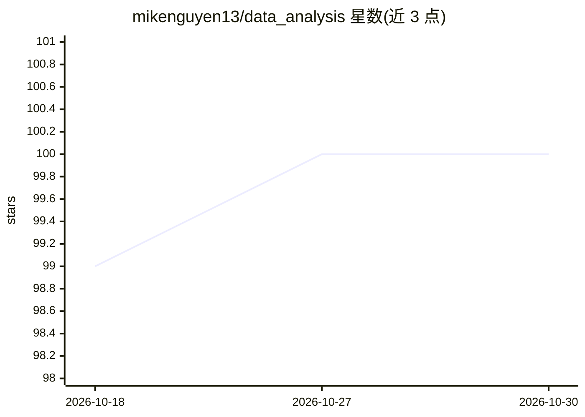

# mikenguyen13/data_analysis

⭐ 100 · Stata · NOASSERTION · 推送 2026-10-17 · [GitHub](https://github.com/mikenguyen13/data_analysis) · [官网](https://bookdown.org/mike/data_analysis/) · 个人维护

**面向零基础读者的数据分析与因果推断开源书籍（R）**

用 bookdown 编写的在线开放书籍，覆盖描述统计、回归（OLS/GLS/MLE/惩罚回归）、广义线性与混合模型、因果推断（DID 现代估计量、断点回归、合成控制、工具变量、匹配、DAG）、敏感性分析与可复现工作流，面向缺乏统计背景、想建立统计直觉与 R 实践能力的读者。纸质版由 Springer Cham 分四卷出版，在线版以 CC BY-NC-SA 4.0 发布。本地构建需 R 与 bookdown，PDF 路线需 LuaLaTeX，用 renv 锁定包版本。

## 筛选速览

| 维度 | 判定 | 备注 |
|---|---|---|
| AI 角色 | `ai-knowledge` | 知识聚合/清单类 |
| 许可风险 | `none` | NOASSERTION |
| 部署形态 | `None` |  |
| 模型依赖 | — | README 未给出锁定关系 |
| 硬件要求 | — | 无带数字的原话,不猜 |
| 安装摩擦 | `low` | 无编译、无系统依赖或容器化 |
| 成熟度 | — | 结构信号不足 |

## 能力要点

- 覆盖从描述统计到现代因果推断方法（含 Callaway-Sant'Anna、rdrobust、sensemakr 等工具）
- Springer Cham 2025 四卷纸质版对应的开放在线版
- bookdown 构建，可渲染 HTML/PDF/EPUB 三种格式

## 适用场景

- 零基础读者系统学习统计与 R 实践技能
- 查找因果推断现代估计量（DID/RDV/合成控制等）方法参考
- 复现书中示例并本地构建书籍

## 场景标签

`教程课程` · 领域:学习与行业

## 证据(README 行号)

> L16: A book on data analysis, causal inference, and econometrics, written for readers with little to no prior background
> L29: * **Causal inference**: difference-in-differences with the modern staggered estimators (Goodman-Bacon, Callaway-San

## 星数曲线

2026-10-18 99 → 2026-10-30 100（+1）

---
*卡片 v1 · prompt 1.4 · 生成 2026-10-23 · 置信度 high · 依据 README sha `de28014809d9` · [字段定义](../../DATASET.md)*
