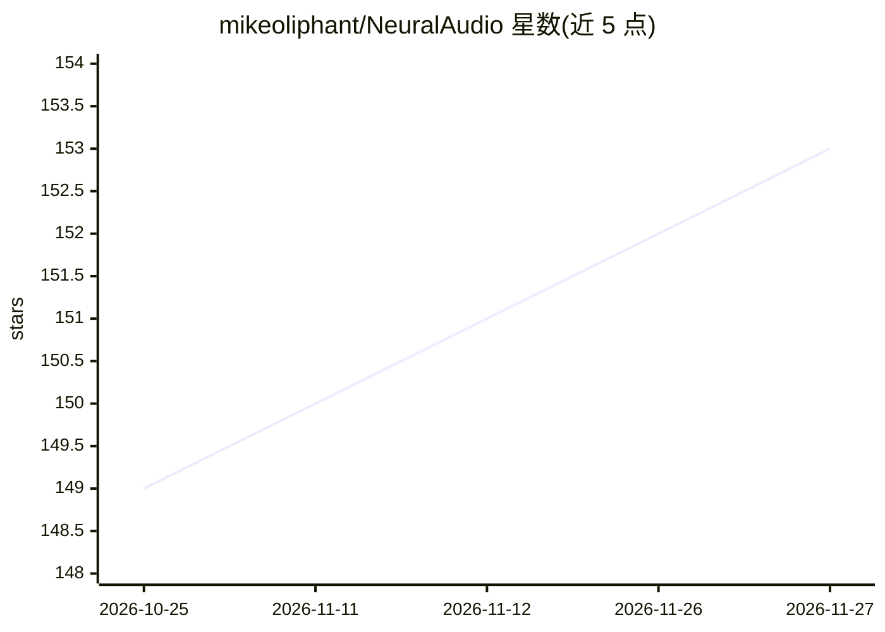

# mikeoliphant/NeuralAudio

⭐ 153 · C++ · MIT · 推送 2026-11-25 · [GitHub](https://github.com/mikeoliphant/NeuralAudio) · 个人维护

**实时音频中运行神经放大器模型的 C++ 库**

C++ 库，用于在实时音频应用中加载和运行神经网络音频模型，主要面向吉他放大器捕获/配置文件（NAM）。支持 NAM WaveNet 与 LSTM 模型（A1/A2）以及 RTNeural keras 模型，内置针对多种模型架构的优化静态实现，不支持的模型回退到动态实现。提供模型加载器 API、缓冲区大小设置、输入/输出电平校准、质量缩放、过采样与元数据读取等机制。通过 git clone 与 CMake 源码构建，编译优化标志需用户自行设置。

## 筛选速览

| 维度 | 判定 | 备注 |
|---|---|---|
| AI 角色 | `ai-native` | 本体是模型或模型工具 |
| 许可风险 | `permissive` | MIT |
| 部署形态 | `desktop` | 安装包/桌面程序 |
| 模型依赖 | — | README 未给出锁定关系 |
| 硬件要求 | — | 无带数字的原话,不猜 |
| 安装摩擦 | `medium` | 含编译或系统依赖之一 |
| 成熟度 | — | 结构信号不足 |

## 能力要点

- 支持 NAM WaveNet 与 LSTM（A1/A2）及 RTNeural keras 模型的加载与处理
- 内置针对 A1/A2 多种架构的优化静态实现，不支持项回退动态实现
- 提供质量缩放（quality scaling）与 OnDemand 组合模型加载以权衡性能与音质
- 暴露输入/输出电平校准、过采样率调整与模型元数据读取 API

## 适用场景

- 在吉他效果器或音频插件中实时加载神经放大器模型
- 嵌入 C++ 实时音频应用处理神经网络音频模型
- 对比不同加载实现（Internal/NAM Core/RTNeural）的性能与精度

## 场景标签

`推理引擎` · 领域:训练与推理

## 证据(README 行号)

> L3: NeuralAudio is a C++ library designed to make it easy to use neural network machine learning models (ie: guitar ampl
> L11: NeuralAudio currently supports the following model types:

## 星数曲线

2026-10-25 149 → 2026-11-27 153（+4）

---
*卡片 v1 · prompt 1.4 · 生成 2026-11-27 · 置信度 high · 依据 README sha `b47c65ef912d` · [字段定义](../../DATASET.md)*
