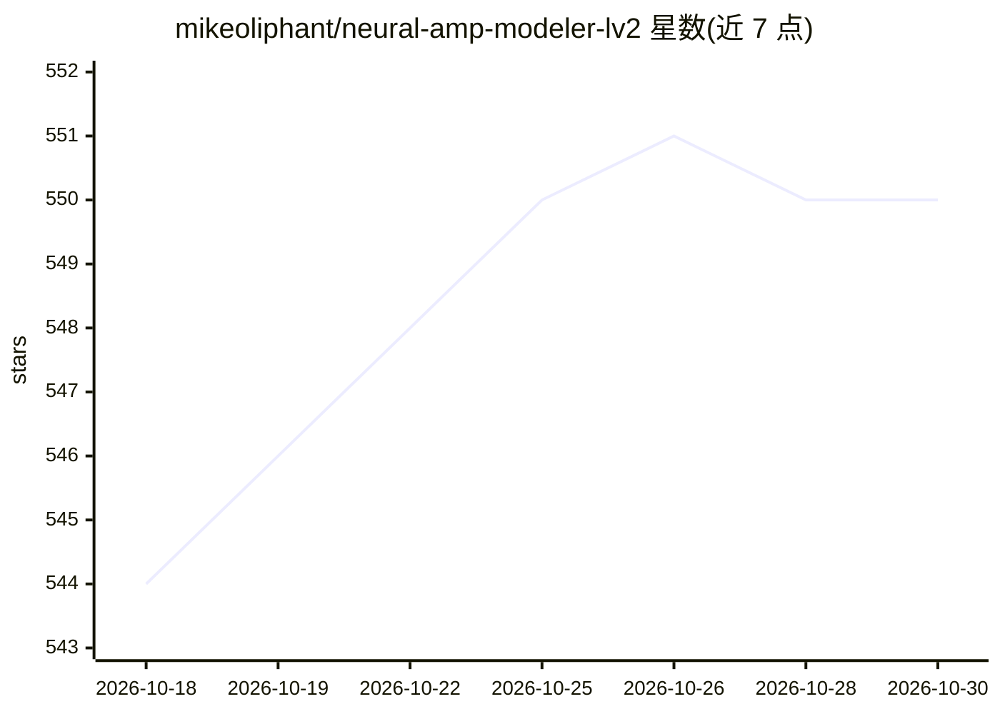

# mikeoliphant/neural-amp-modeler-lv2

⭐ 550 · C++ · GPL-3.0 · 推送 2026-09-04 · [GitHub](https://github.com/mikeoliphant/neural-amp-modeler-lv2) · 个人维护

**吉他音箱神经网络模型的 LV2 播放插件**

基于 NeuralAudio 引擎的 LV2 音频插件，用于加载并运行神经网络机器学习音箱模型（NAM A1/A2 与 RTNeural keras json 模型，如 Aida-X 所用）。无自定义界面，需宿主支持 atom:Path 参数（Reaper 6.82+ 支持）；模型采样率须与宿主一致，支持偶数倍过采样；amp-only 模型后需接冲激响应模拟箱体。提供 Linux/macOS/Windows 源码编译方式（CMake）。

## 筛选速览

| 维度 | 判定 | 备注 |
|---|---|---|
| AI 角色 | `ai-native` | 本体是模型或模型工具 |
| 许可风险 | `viral` | GPL-3.0 |
| 部署形态 | `desktop` | 安装包/桌面程序 |
| 模型依赖 | — | README 未给出锁定关系 |
| 硬件要求 | — | 无带数字的原话,不猜 |
| 安装摩擦 | `medium` | 含编译或系统依赖之一 |
| 成熟度 | — | 结构信号不足 |

## 能力要点

- 支持 NAM A1/A2 与 RTNeural keras json 模型播放
- 输入/输出增益、模型质量与模型文件选择控制
- 偶数倍采样率过采样（减少混叠，性能开销较高）
- 输入按 12dBu 校准，支持静音智能旁路选项

## 适用场景

- 在 Reaper 等 LV2 宿主/DAW 中加载 .nam 音箱模型做吉他音色处理
- 配合冲激响应完成箱体模拟
- 用过采样降低混叠失真

## 场景标签

`推理引擎` · 领域:训练与推理

## 证据(README 行号)

> L3: LV2 plugin for neural network machine learning amp model playback using the NeuralAudio engine.
> L26: The plugin supports both Neural Amp Modeler (NAM) models (both A1 and A2) and RTNeural keras json models (like thos

## 星数曲线

2026-10-18 544 → 2026-10-30 550（+6）

---
*卡片 v1 · prompt 1.4 · 生成 2026-10-21 · 置信度 high · 依据 README sha `f4252b4323a3` · [字段定义](../../DATASET.md)*
