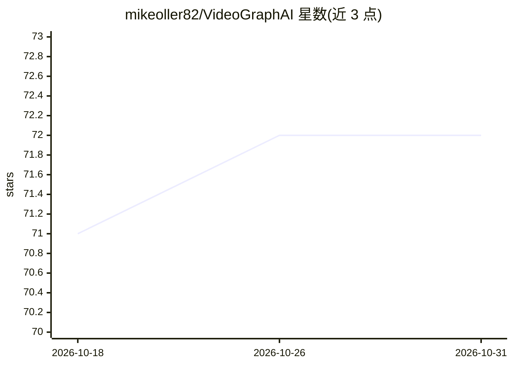

# mikeoller82/VideoGraphAI

⭐ 72 · Python · 推送 2026-02-11 · [GitHub](https://github.com/mikeoller82/VideoGraphAI) · 个人维护

**面向 YouTube Shorts 创作者的 AI 短视频自动生成工具**

基于 Streamlit 的开源视频自动化工具：用户输入主题、时间范围与时长，系统经 Tavily API 实时检索研究，用 LLM（Groq 等）生成标题、描述、话题标签与脚本，通过 TogetherAI 的 FLUX.schnell 生图，F5-TTS 生成配音，Gentle（Docker 运行）生成同步字幕，最终合成可下载的短视频。需配置多个 API key，并本地安装 F5-TTS、FFmpeg 等组件，面向内容创作者与自部署用户。

## 筛选速览

| 维度 | 判定 | 备注 |
|---|---|---|
| AI 角色 | `ai-native` | 本体是模型或模型工具 |
| 许可风险 | `none` | — |
| 部署形态 | `self-host` | docker 或自建部署 |
| 模型依赖 | locked-api |  |
| 硬件要求 | — | 无带数字的原话,不猜 |
| 安装摩擦 | `low` | 无编译、无系统依赖或容器化 |
| 成熟度 | — | 结构信号不足 |

## 能力要点

- 从主题输入到成片输出的端到端短视频生成流程
- 实时内容研究（Tavily Search API）与 LLM 脚本生成
- FLUX.schnell 图像生成与 F5-TTS 语音合成
- Gentle 服务生成同步字幕，Streamlit 界面交付成片

## 适用场景

- 我想只输入一个主题就自动产出一条带配音和字幕的短视频
- 批量制作时事类短视频内容
- 自动化选题研究、脚本撰写到成片的完整流程

## 场景标签

`视频生成` · 领域:内容生成

## 证据(README 行号)

> L10: An open-source AI-powered YouTube Shorts automation tool that revolutionizes content creation using graph-based age
> L24: - 🔍 **Real-time Research**: Automated content research using Tavily Search API
> L25: - 📝 **AI Script Generation**: Flexible LLM compatibility (OpenAI, Groq, etc.)

## 星数曲线

2026-10-18 71 → 2026-10-31 72（+1）

---
*卡片 v1 · prompt 1.4 · 生成 2026-10-24 · 置信度 mid · 依据 README sha `3d7a6d29dcb2` · [字段定义](../../DATASET.md)*
