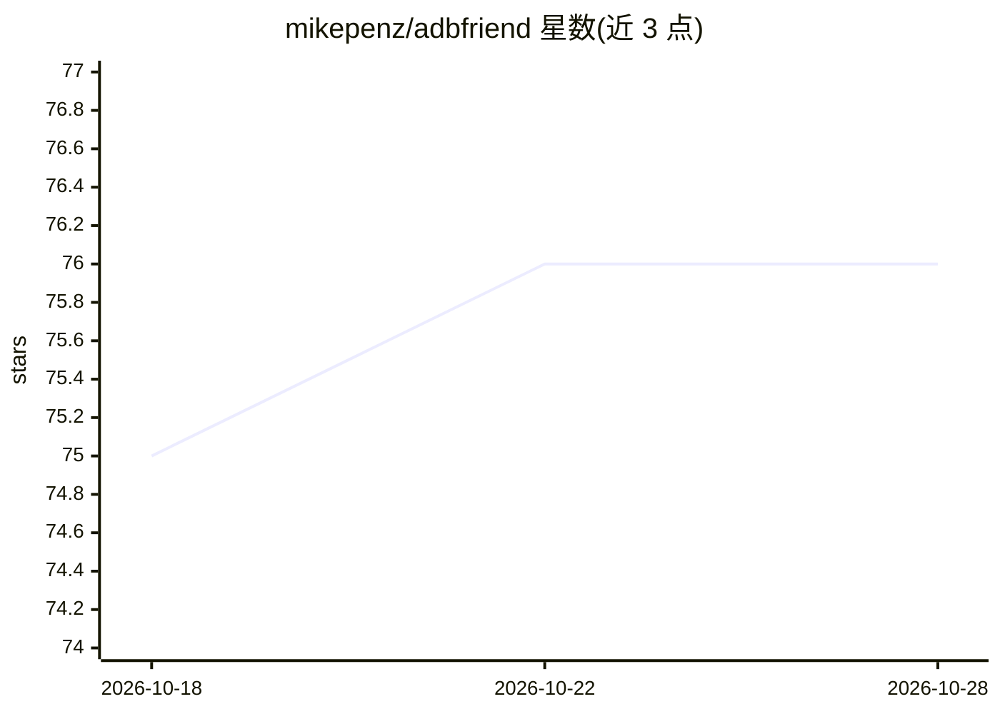

# mikepenz/adbfriend

⭐ 76 · Kotlin · Apache-2.0 · 推送 2026-10-27 · [GitHub](https://github.com/mikepenz/adbfriend) · 个人维护

**带 MCP Server 的 Android ADB 命令行管理工具**

面向 Android 开发者的 ADB 命令行工具（Kotlin/KMP 构建）：提供文件同步（跳过设备已有文件）、测试设备配置（禁用动画等）、按模式卸载应用、对匹配 glob 的包施加沉浸式标志/强制停止/清数据、USB 连接速度检测等功能。自 1.4.0 起内置 MCP Server，可配置到 Claude Desktop、GitHub Copilot 等 AI 工具，暴露 19 个工具（截屏、读写文件、装卸 APK、列出设备等），需提供 ANDROID_HOME 或手动启动 adb-server。通过 Homebrew 安装或下载预编译二进制。

## 筛选速览

| 维度 | 判定 | 备注 |
|---|---|---|
| AI 角色 | `ai-enhanced` | 去掉 AI 部分产品仍成立 |
| 许可风险 | `permissive` | Apache-2.0 |
| 部署形态 | `desktop` | 安装包/桌面程序 |
| 模型依赖 | — | README 未给出锁定关系 |
| 硬件要求 | — | 无带数字的原话,不猜 |
| 安装摩擦 | `low` | 无编译、无系统依赖或容器化 |
| 成熟度 | — | 结构信号不足 |

## 能力要点

- 内置 MCP Server，可接入 Claude Desktop、GitHub Copilot、RayCast 等 AI 工具
- MCP 提供 19 个工具：截屏、读写设备文件、装卸 APK、强制停止、清数据等
- 按 glob 匹配包批量施加沉浸式标志/强停/清理
- adb-speed 检测 USB 线缆连接速度

## 适用场景

- Android 开发与测试时批量配置设备、同步测试数据
- 让 Claude Desktop 等 AI 助手直接操作连接的 Android 设备（装 APK、整理文件、截屏）
- 识别数据线质量不佳导致的连接问题

## 场景标签

 · 领域:开发工具/移动设备管理

## 证据(README 行号)

> L3: ADB Friend is a tiny cli tool, which helps you to manage your Android device via ADB.
> L17: - Model Context Protocol MCP Server
> L46: ADB Friend (Since version 1.4.0) also provides

## 星数曲线

2026-10-18 75 → 2026-10-28 76（+1）

---
*卡片 v1 · prompt 1.4 · 生成 2026-10-24 · 置信度 mid · 依据 README sha `85a9884fa911` · [字段定义](../../DATASET.md)*
