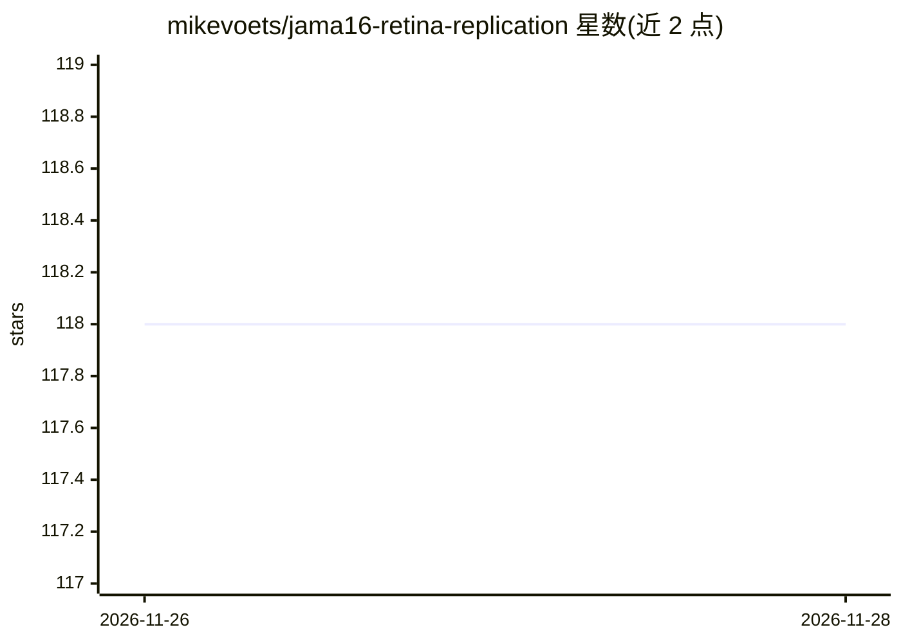

# mikevoets/jama16-retina-replication

⭐ 118 · Python · MIT · 推送 2026-11-25 · [GitHub](https://github.com/mikevoets/jama16-retina-replication) · [官网](https://doi.org/10.1371/journal.pone.0217541) · 个人维护

**复现 JAMA 2016 糖尿病视网膜病变检测研究的代码**

对 JAMA 2016 深度学习糖尿病视网膜病变检测研究的复现工程：用 Kaggle EyePACS 与 Messidor 数据重新实现并训练 Inception-v3 模型，提供预处理脚本、训练（断点续训）、单模型/集成评估与混淆矩阵、特异度/敏感度输出。结论：公开数据下 AUC（0.951/0.853）未达原文 0.99。提供 figshare 已训练模型下载与 GPU 基准 Docker 镜像。训练实用上需 GPU；数据集脚本依赖 Linux 工具。附论文指出已训练模型与论文描述存在差异，寻求 GPU 重新训练。

## 筛选速览

| 维度 | 判定 | 备注 |
|---|---|---|
| AI 角色 | `ai-native` | 本体是模型或模型工具 |
| 许可风险 | `permissive` | MIT |
| 部署形态 | `self-host` | docker 或自建部署 |
| 模型依赖 | — | README 未给出锁定关系 |
| 硬件要求 | — | 无带数字的原话,不猜 |
| 安装摩擦 | `low` | 无编译、无系统依赖或容器化 |
| 成熟度 | — | 结构信号不足 |

## 能力要点

- 用公开数据集重新实现并复现 JAMA 2016 视网膜病变检测方法
- 提供训练、断点续训、单模型与集成评估脚本
- 发布已训练模型（figshare）与配套论文（PONE）
- 提供 Docker 基准镜像与 Kubernetes 分布式基准配置示例

## 适用场景

- 复现或验证糖尿病视网膜病变检测研究的训练流程
- 在自备眼底图像数据集上训练/评估该模型结构
- 医学影像深度学习方法可复现性研究

## 场景标签

`目标检测` · 领域:感知与多模态

## 证据(README 行号)

> L11: We have attempted to replicate the methods and reproduce the results in _Development and validation of a deep learn
> L15: We were not able to reproduce the original study’s results with publicly available data. Our algorithm’s area under
> L70: To start training with default settings, run `$ python train.py`. The model with the highest validation AUC is save

## 星数曲线

2026-11-26 118 → 2026-11-28 118（+0）

---
*卡片 v1 · prompt 1.4 · 生成 2026-11-26 · 置信度 mid · 依据 README sha `8d6322f575c1` · [字段定义](../../DATASET.md)*
