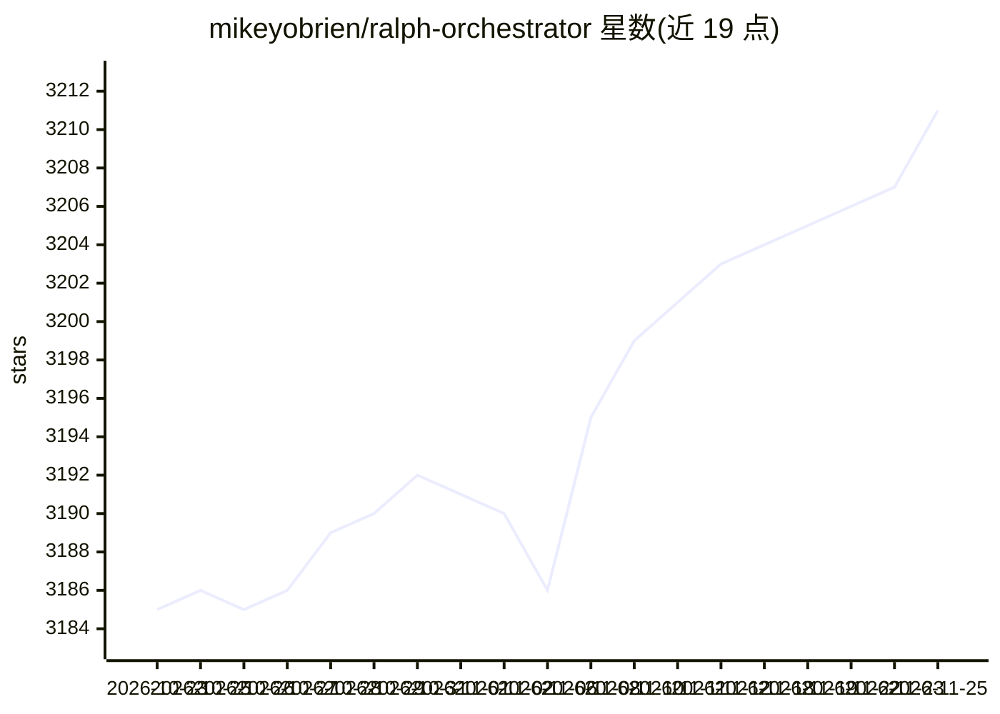

# mikeyobrien/ralph-orchestrator

⭐ 3,211 · Rust · MIT · 推送 2026-11-13 · [GitHub](https://github.com/mikeyobrien/ralph-orchestrator) · 个人维护

**让 AI 编码 agent 循环迭代直到任务完成的编排框架**

实现 Ralph Wiggum 技术的编排框架：将 Claude Code、Gemini CLI 等 AI 编码助手置于循环中持续迭代，直到输出 LOOP_COMPLETE 或达到迭代上限。通过"帽子"人格系统经事件协调分工，内置 tests/lint/typecheck 背压门拒绝不完整产出，提供持久化记忆与任务跟踪、5 个内置模式（code-assist/debug/research/review 等）。以 Rust CLI 分发，附带 Alpha 阶段的 Web 监控面板、MCP server 模式与 Telegram 人机交互通道。

## 筛选速览

| 维度 | 判定 | 备注 |
|---|---|---|
| AI 角色 | `ai-ecosystem` | LLM/agent 周边工具 |
| 许可风险 | `permissive` | MIT |
| 部署形态 | `library` | 以包/库形式分发 |
| 模型依赖 | — | README 未给出锁定关系 |
| 硬件要求 | — | 无带数字的原话,不猜 |
| 安装摩擦 | `low` | 无编译、无系统依赖或容器化 |
| 成熟度 | `idea` | |

## 能力要点

- 多后端支持：Claude Code、Kiro、Gemini CLI、Codex、Forge、Amp 等 11 种 CLI
- Hat 人格系统经事件协调，含 code-assist/debug/research/review 等 5 个内置模式
- 背压门（tests/lint/typecheck）拒绝不完整工作，循环至完成或迭代上限
- 可作为 MCP server 运行，并提供 Telegram 人机在环交互

## 适用场景

- 让 AI 编码助手自主迭代完成一个开发任务而不是单轮对话
- 通过 Telegram 在 agent 循环运行中回答提问或中途给指引
- 用 MCP 客户端接入按工作区隔离的编排服务

## 场景标签

`编码 Agent` `多智能体` · 领域:Agent 开发

## 证据(README 行号)

> L12: A hat-based orchestration framework that keeps AI agents in a loop until the task is done.
> L133: - **Multi-Backend Support** — Claude Code, Kiro, Gemini CLI, Codex, Forge, Amp, Copilot CLI, OpenCode, Pi, Roo, OM
> L184: Ralph is a hat-based orchestration framework that implements the Ralph Wiggum technique — autonomous task completi

## 星数曲线

2026-10-23 3,185 → 2026-11-25 3,211（+26）

---
*卡片 v1 · prompt 1.4 · 生成 2026-11-23 · 置信度 high · 依据 README sha `fdef11a80b48` · [字段定义](../../DATASET.md)*
