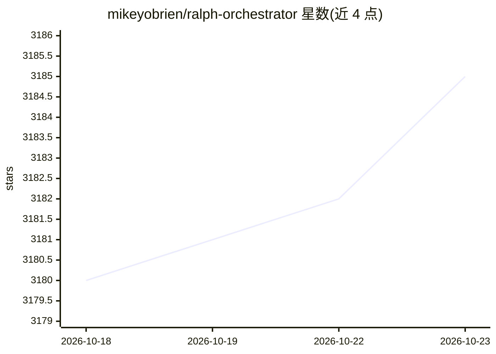

# mikeyobrien/ralph-orchestrator

⭐ 3,185 · Rust · MIT · 推送 2026-10-15 · [GitHub](https://github.com/mikeyobrien/ralph-orchestrator) · 个人维护

**让 AI 编码助手循环迭代直至任务完成的编排框架**

Rust 实现的 hat-based 自治代理编排框架，将 AI 编码助手 CLI（Claude Code、Codex、Gemini CLI、Copilot CLI、Kiro 等 11 种后端）置于循环中持续迭代，直到输出 LOOP_COMPLETE 或达到迭代上限。机制包括：专门角色的 hat 系统、拒绝不完整工作的 backpressure 门（测试/lint/类型检查）、持久化 memories 与 tasks。另提供 Web 监控面板（Alpha）、MCP server 模式、Telegram 人在回路交互。系统要求 Rust 1.75+ 与 Node.js >= 18。

## 筛选速览

| 维度 | 判定 | 备注 |
|---|---|---|
| AI 角色 | `ai-ecosystem` | LLM/agent 周边工具 |
| 许可风险 | `permissive` | MIT |
| 部署形态 | `library` | 以包/库形式分发 |
| 模型依赖 | locked-api |  |
| 硬件要求 | — | 无带数字的原话,不猜 |
| 安装摩擦 | `low` | 无编译、无系统依赖或容器化 |
| 成熟度 | `idea` | |

## 能力要点

- 支持 11 种 AI 编码 CLI 后端（Claude Code、Codex、Gemini CLI 等）
- backpressure 门：测试/lint/typecheck 未过则拒绝工作
- 持久化 memories 与 tasks 的运行时追踪
- MCP server 模式与 Telegram 人在回路（RObot）

## 适用场景

- 让编码代理自主迭代完成多步开发任务直到通过测试
- 通过 Telegram 在编排过程中向代理提问或下达指令
- 用 Web 面板监控和管理编排循环

## 场景标签

`编码 Agent` · 领域:编码与开发

## 证据(README 行号)

> L12: A hat-based orchestration framework that keeps AI agents in a loop until the task is done.
> L133: - **Multi-Backend Support** — Claude Code, Kiro, Gemini CLI, Codex, Forge, Amp, Copilot CLI, OpenCode, Pi, Roo, OM

## 星数曲线

2026-10-18 3,180 → 2026-10-23 3,185（+5）

---
*卡片 v1 · prompt 1.4 · 生成 2026-10-20 · 置信度 high · 依据 README sha `b814e4ebde1b` · [字段定义](../../DATASET.md)*
