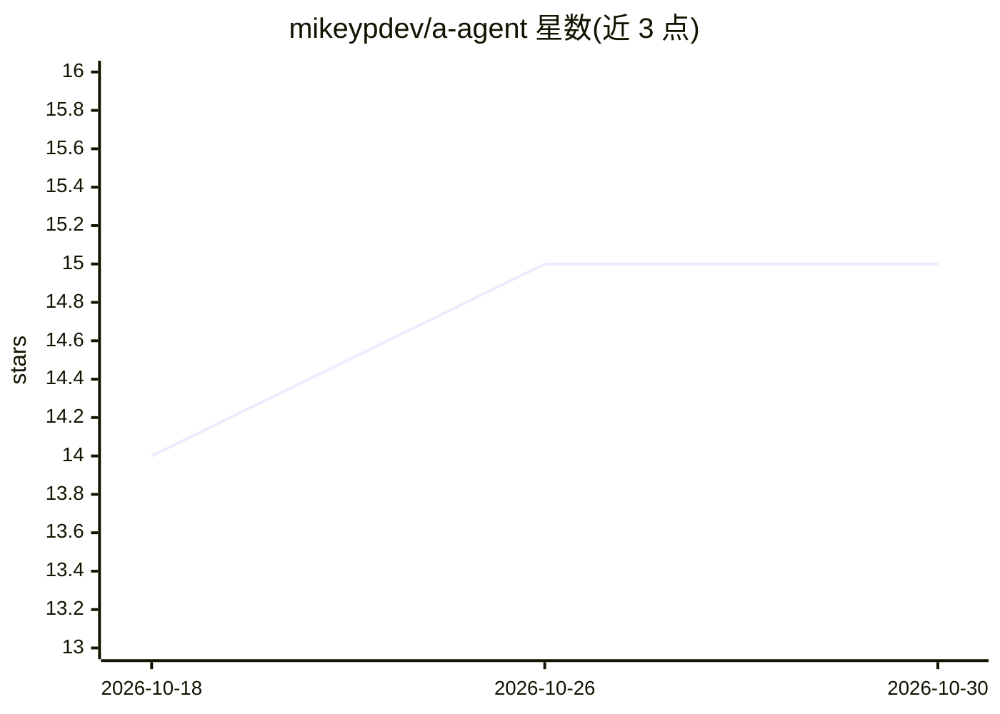

# mikeypdev/a-agent

⭐ 15 · Python · MIT · 推送 2026-05-19 · [GitHub](https://github.com/mikeypdev/a-agent) · 个人维护

**面向 iPad/iOS a-Shell 终端的单文件 AI 编码 agent**

单文件 Python 实现的极简 AI 编码 agent，为 iOS/iPadOS 上的 a-Shell 终端设计，也可在任何装有 Python 3 的系统运行。通过 OpenRouter API 或任意 OpenAI 兼容端点接入 LLM，默认模型 anthropic/claude-sonnet-4-5。为模型提供读写编辑文件、运行 shell 命令、正则搜索、glob、DuckDuckGo 网页搜索与网页转 Markdown 阅读 9 种工具，支持流式输出、实时 thinking 展示与语法高亮，接近上下文上限时自动摘要压缩。README 明确声明无安全护栏、可读写删除用户可访问的任意文件；a-Shell 上大量 shell 调用可能导致崩溃。安装方式为 pip 安装三个依赖后直接运行脚本。

## 筛选速览

| 维度 | 判定 | 备注 |
|---|---|---|
| AI 角色 | `ai-native` | 本体是模型或模型工具 |
| 许可风险 | `permissive` | MIT |
| 部署形态 | `library` | 以包/库形式分发 |
| 模型依赖 | locked-api |  |
| 硬件要求 | — | 无带数字的原话,不猜 |
| 安装摩擦 | `low` | 无编译、无系统依赖或容器化 |
| 成熟度 | — | 结构信号不足 |

## 能力要点

- 单文件 Python 实现，专为 iOS/iPadOS 的 a-Shell 终端设计
- 通过 OpenRouter API 或任意 OpenAI 兼容端点接入 LLM
- 提供 9 种工具：文件读写编辑、shell 执行、grep/glob、网页搜索与网页转 Markdown
- 历史接近上下文 80% 时自动摘要压缩对话

## 适用场景

- 在 iPad 上通过 a-Shell 终端进行 AI 辅助编码
- 让 agent 读写代码文件、执行命令并运行测试验证改动
- 通过 AGENTS.md 注入项目专属上下文与编码规范

## 场景标签

`编码 Agent` · 领域:编码与开发

## 证据(README 行号)

> L3: A minimal, single-file AI coding agent optimized for terminal-based workflows. Designed specifically for a-Shell on 
> L5: It connects to LLMs via the OpenRouter API (or any OpenAI-compatible endpoint) and gives the model tools to read, wr

## 星数曲线

2026-10-18 14 → 2026-10-30 15（+1）

---
*卡片 v1 · prompt 1.4 · 生成 2026-10-30 · 置信度 high · 依据 README sha `a50fd41eabf7` · [字段定义](../../DATASET.md)*
