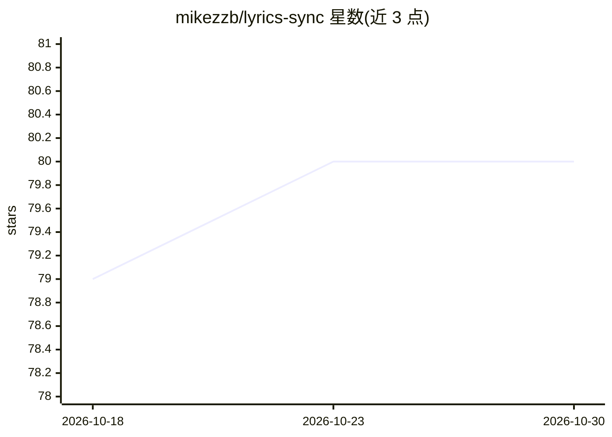

# mikezzb/lyrics-sync

⭐ 80 · Jupyter Notebook · Apache-2.0 · 推送 2026-01-12 · [GitHub](https://github.com/mikezzb/lyrics-sync) · 个人维护

**深度学习歌词-音频对齐系统：生成逐词时间戳的 .lrc 文件**

Python 库 lsync，输入歌曲音频与歌词文本，输出词级起止时间的 .lrc 对齐歌词。流程分三步：分离人声、识别歌唱人声、强制对齐；歌唱识别采用迁移学习将语音域知识迁移到歌唱域。默认可通过 conda 环境安装，提供 demo.ipynb 演示；另含实验流程，支持基于 DALI 数据集微调 facebook/wav2vec2-base 以提升歌唱域识别效果。

## 筛选速览

| 维度 | 判定 | 备注 |
|---|---|---|
| AI 角色 | `ai-native` | 本体是模型或模型工具 |
| 许可风险 | `permissive` | Apache-2.0 |
| 部署形态 | `None` |  |
| 模型依赖 | — | README 未给出锁定关系 |
| 硬件要求 | — | 无带数字的原话,不猜 |
| 安装摩擦 | `low` | 无编译、无系统依赖或容器化 |
| 成熟度 | — | 结构信号不足 |

## 能力要点

- 三步流水线：人声分离（Demucs）→ 歌声识别 → 强制对齐
- 输出词级 onset/offset 的 .lrc 文件
- 基于 Wav2Vec2 的语音到歌唱域迁移学习
- 提供 DALI 数据集上的 Wav2Vec2 微调实验流程

## 适用场景

- 为一首带歌词的歌曲生成逐词时间同步的 .lrc 歌词文件
- 微调 Wav2Vec2 以提升歌唱人声识别效果
- 在音乐信息检索任务中做歌词-音频对齐实验

## 场景标签

`微调` · 领域:训练与推理

## 证据(README 行号)

> L3: This project aims to build a lyrics-to-audio alignment system that can synchronize the audio of a polyphonic song wi

## 星数曲线

2026-10-18 79 → 2026-10-30 80（+1）

---
*卡片 v1 · prompt 1.4 · 生成 2026-10-24 · 置信度 high · 依据 README sha `5833bd5cc5fc` · [字段定义](../../DATASET.md)*
