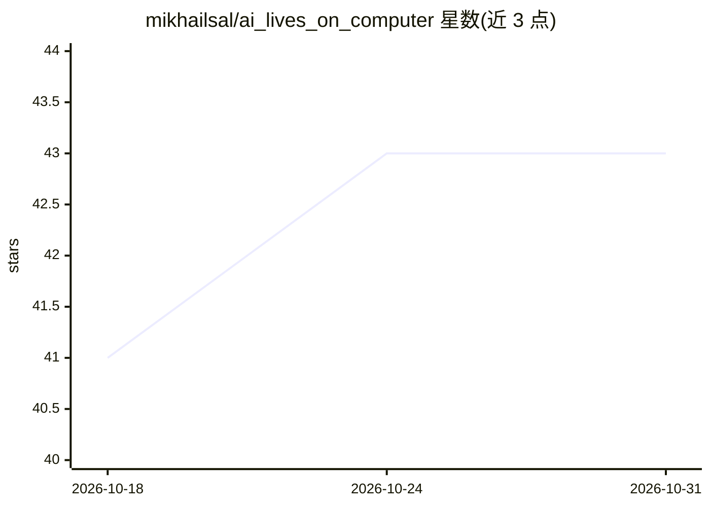

# mikhailsal/ai_lives_on_computer

⭐ 43 · Shell · 推送 2026-03-10 · [GitHub](https://github.com/mikhailsal/ai_lives_on_computer) · 个人维护

**让自主 AI 代理驻留服务器的实验框架**

在 Linux 服务器上为 AI 代理建立持久“住所”的实验框架：代理经 cron 定期唤醒，通过 SYSTEM_PROMPT.md 与自身写下的状态文件（session_counter.txt、last_session.md）在无内在记忆的会话间延续上下文。底层引擎为 pip 安装的 mini-swe-agent，配合 live-swe-agent 配置实现自建工具、反思与自我修改；模型经 OpenRouter API（含免费模型）访问。部署需 SSH 服务器，最低 1 GB 内存，ARIA v1 曾运行 489 个会话后因 Qwen 关闭外部 OAuth 而迁移到 OpenRouter。

## 筛选速览

| 维度 | 判定 | 备注 |
|---|---|---|
| AI 角色 | `ai-ecosystem` | LLM/agent 周边工具 |
| 许可风险 | `none` | — |
| 部署形态 | `library` | 以包/库形式分发 |
| 模型依赖 | locked-api |  |
| 硬件要求 | — | 无带数字的原话,不猜 |
| 安装摩擦 | `low` | 无编译、无系统依赖或容器化 |
| 成熟度 | `idea` | |

## 能力要点

- cron 定期唤醒代理，跨会话状态靠自身写下的文件延续
- 代理可修改自身指令与唤醒配置（自我修改能力）
- 基于 mini-swe-agent 引擎，经 OpenRouter 访问 400+ 模型（含免费）
- 提供 deploy.sh 从本地经 SSH 别名部署到服务器

## 适用场景

- 观察无指定任务的自主 AI 代理在服务器上的长期行为
- 研究跨会话持久记忆与自我演化机制
- 在低成本 VPS 或树莓派上运行常驻 AI 实验

## 场景标签

`Agent 框架` · 领域:Agent 开发

## 证据(README 行号)

> L32: - **`mini-swe-agent`** — the underlying AI agent engine (installed via pip, command: `mini`)
> L36: - **OpenRouter** — provides access to 400+ AI models via a unified API (many are **free**)
> L11: This project gives an AI agent its own "home" on a Linux server. The AI wakes up periodically (via cron), exists fo

## 星数曲线

2026-10-18 41 → 2026-10-31 43（+2）

---
*卡片 v1 · prompt 1.4 · 生成 2026-10-25 · 置信度 mid · 依据 README sha `78fb6e25b1dc` · [字段定义](../../DATASET.md)*
