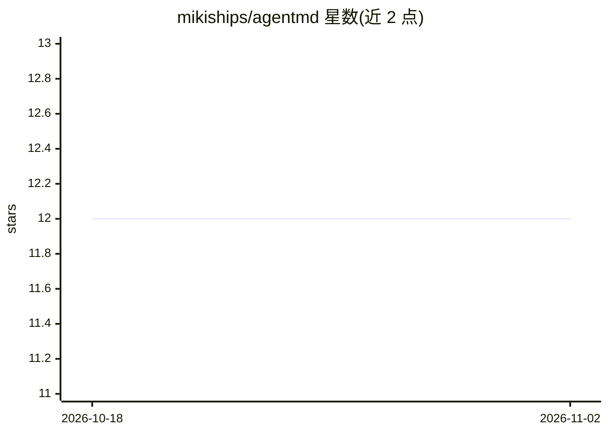

# mikiships/agentmd

⭐ 12 · Python · MIT · 推送 2026-03-22 · [GitHub](https://github.com/mikiships/agentmd) · [官网](https://pypi.org/project/agentmd-gen/) · 个人维护

**从代码库生成 AI 编程助手的上下文文件并评分**

Python CLI 工具，扫描 Python/Swift/Rust/Go/TypeScript 等代码库，生成 CLAUDE.md、AGENTS.md、.cursorrules、Copilot 指令文件，供 Claude Code、OpenAI Codex、Cursor、GitHub Copilot 等 AI 编程助手读取。提供 scan/generate/score/diff/drift/eval 六个子命令：score 按 5 个维度（各 20 分）评分，drift 检测文件与代码库的漂移并可接入 GitHub Action，eval 生成后可配合 coderace（可选）测性能影响。支持 --minimal 与 --tiered（分层目录+触发表）两种生成模式，tiered 模式建议用于 20 个源文件以上项目。

## 筛选速览

| 维度 | 判定 | 备注 |
|---|---|---|
| AI 角色 | `ai-ecosystem` | LLM/agent 周边工具 |
| 许可风险 | `permissive` | MIT |
| 部署形态 | `library` | 以包/库形式分发 |
| 模型依赖 | — | README 未给出锁定关系 |
| 硬件要求 | — | 无带数字的原话,不猜 |
| 安装摩擦 | `medium` | 含编译或系统依赖之一 |
| 成熟度 | — | 结构信号不足 |

## 能力要点

- 扫描代码库生成 4 类 agent 上下文文件（Claude Code/Codex/Cursor/Copilot）
- score 子命令按 5 维度（完整性/具体性/清晰度/agent 感知/新鲜度）打 0-100 分
- drift 子命令检测上下文漂移并提供 GitHub Action 集成
- --tiered 模式自动检测子系统边界生成分层上下文目录

## 适用场景

- 为 AI 编程助手快速生成项目上下文文件
- 在 CI 中检测上下文文件与代码库的漂移
- 给已有的 CLAUDE.md 打分找出可改进之处

## 场景标签

`提示工程` · 领域:Agent 开发

## 证据(README 行号)

> L8: agentmd analyzes your codebase and generates optimized context files for AI coding agents. Point it at any Python, S
> L219: - **agentmd** — Generate and score context files for AI coding agents.

## 星数曲线

2026-10-18 12 → 2026-11-02 12（+0）

---
*卡片 v1 · prompt 1.4 · 生成 2026-11-01 · 置信度 high · 依据 README sha `c77971c211c2` · [字段定义](../../DATASET.md)*
