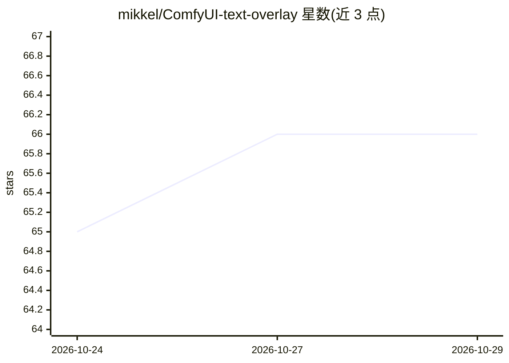

# mikkel/ComfyUI-text-overlay

⭐ 66 · Python · 推送 2026-10-23 · [GitHub](https://github.com/mikkel/ComfyUI-text-overlay) · 个人维护

**ComfyUI 插件：在图像上叠加自定义文字**

面向 ComfyUI 用户的文字叠加节点插件：读取图像并按指定内容渲染文字后输出图像，支持系统字体路径、字号、RGB（hex）颜色、x/y 坐标定位与左/中/右对齐设置，README 提到可与 ControlNet 工作流搭配。安装方式为在 ComfyUI 环境内安装 requirements.txt 并重启，要求 Python 3.11 或更新版本；仓库更改不会更新已运行的 ComfyUI 进程。

## 筛选速览

| 维度 | 判定 | 备注 |
|---|---|---|
| AI 角色 | `ai-ecosystem` | LLM/agent 周边工具 |
| 许可风险 | `none` | — |
| 部署形态 | `None` |  |
| 模型依赖 | — | README 未给出锁定关系 |
| 硬件要求 | — | 无带数字的原话,不猜 |
| 安装摩擦 | `low` | 无编译、无系统依赖或容器化 |
| 成熟度 | — | 结构信号不足 |

## 能力要点

- 通过 x/y 坐标指定文字位置
- 支持任意系统字体路径与字号调整
- RGB（hex）自定义文字颜色与左/中/右对齐

## 适用场景

- 在 ComfyUI 工作流中给生成图像加水印或标注文字
- 与 ControlNet 工作流配合输出带文字的图像

## 场景标签

`图像视频处理` · 领域:感知与多模态

## 证据(README 行号)

> L1: # ComfyUI - Text Overlay Plugin
> L6: The ComfyUI Text Overlay Plugin provides functionalities for superimposing text on images. Users can select differen

## 星数曲线

2026-10-24 65 → 2026-10-29 66（+1）

---
*卡片 v1 · prompt 1.4 · 生成 2026-10-24 · 置信度 high · 依据 README sha `6312be51ce14` · [字段定义](../../DATASET.md)*
