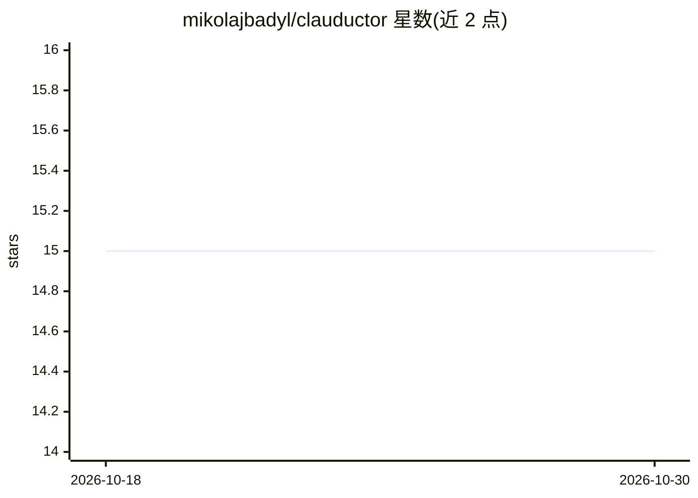

# mikolajbadyl/clauductor

⭐ 15 · Vue · MIT · 推送 2026-03-10 · [GitHub](https://github.com/mikolajbadyl/clauductor) · 个人维护

**Claude Code 的自托管可视化 Web 界面**

为 Claude Code 提供浏览器端图形界面的自托管工具：以实时执行地图展示工具调用、文件编辑与 bash 命令，支持流式命令输出、会话历史与恢复、多并发会话，内置 MCP 服务器用于工具审批提示。以单二进制形式分发，无额外依赖，支持 Linux/macOS/Windows，可通过安装脚本、Releases 下载或 make build 从源码构建，默认监听 localhost:8080，可在自有服务器部署后从任意设备访问。

## 筛选速览

| 维度 | 判定 | 备注 |
|---|---|---|
| AI 角色 | `ai-ecosystem` | LLM/agent 周边工具 |
| 许可风险 | `permissive` | MIT |
| 部署形态 | `None` |  |
| 模型依赖 | — | README 未给出锁定关系 |
| 硬件要求 | — | 无带数字的原话,不猜 |
| 安装摩擦 | `low` | 无编译、无系统依赖或容器化 |
| 成熟度 | — | 结构信号不足 |

## 能力要点

- 实时执行地图：可视化工具调用、文件编辑与 bash 命令
- 浏览器中与 Claude Code 对话，流式查看 bash 输出
- 内置 MCP 服务器用于工具审批提示
- 单二进制分发，无依赖，支持 Linux/macOS/Windows

## 适用场景

- 在浏览器中远程使用并监控 Claude Code 的工作过程
- 自助托管后从任意设备访问 Claude Code
- 管理多个并发会话并恢复历史会话

## 场景标签

`编码 Agent` · 领域:编码与开发

## 证据(README 行号)

> L3: Visual web interface for Claude Code. See your AI's work as a real-time execution map - tool calls, file edits, bash
> L10: - Live chat with Claude Code in the browser
> L12: - Built-in MCP server for tool approval prompts

## 星数曲线

2026-10-18 15 → 2026-10-30 15（+0）

---
*卡片 v1 · prompt 1.4 · 生成 2026-10-30 · 置信度 high · 依据 README sha `b170695ec6dc` · [字段定义](../../DATASET.md)*
