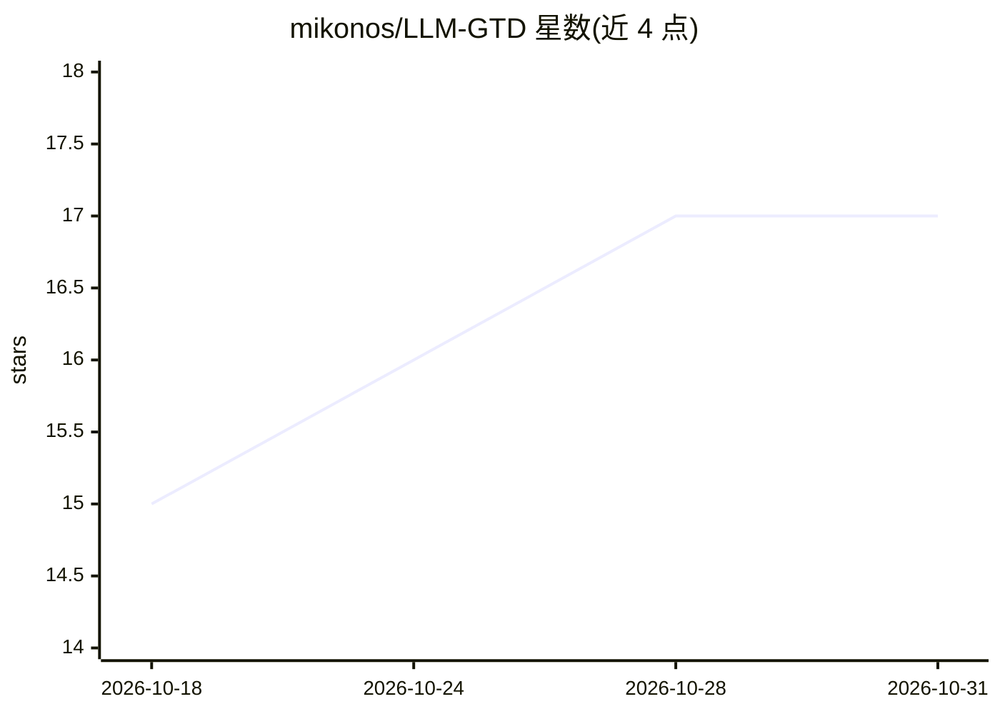

# mikonos/LLM-GTD

⭐ 17 · Shell · MIT · 推送 2026-06-11 · [GitHub](https://github.com/mikonos/LLM-GTD) · 个人维护

**跨 Claude Code/Cursor/Codex 的 GTD 任务管理 agent 技能包**

面向个人用户的 GTD（Getting Things Done）agent 技能包，以 Markdown 文件（memory/gtd/ 下八个清单）作为共享可信状态，通过 /gtd 路由与 init/capture/clarify/update/organize/engage/review 七个工作流命令驱动。设计上 capture/clarify 与机械性整理由 agent 自动执行，engage 与 review 保留人工主导；支持接入外部日历并在失败时如实报告。同一状态可被 Claude Code、Cursor、Codex 三个前端使用。

## 筛选速览

| 维度 | 判定 | 备注 |
|---|---|---|
| AI 角色 | `ai-native` | 本体是模型或模型工具 |
| 许可风险 | `permissive` | MIT |
| 部署形态 | `None` |  |
| 模型依赖 | locked-api |  |
| 硬件要求 | — | 无带数字的原话,不猜 |
| 安装摩擦 | `low` | 无编译、无系统依赖或容器化 |
| 成熟度 | — | 结构信号不足 |

## 能力要点

- 八个 Markdown 清单构成的可信状态，无数据库、无供应商锁定
- capture→clarify→engage→review 完整 GTD 循环，含 /gtd 路由与七个命令
- 同一 memory/gtd/ 状态跨 Claude Code、Cursor、Codex 三平台使用
- 日历写入 fail-closed：外部日历可用时自动写入，失败不假装成功

## 适用场景

- 让 agent 帮我收集和澄清任务、推进项目下一步行动
- 跨多个编程 agent 前端维护同一套 GTD 清单
- 用 AI 准备并辅助执行每周回顾

## 场景标签

`知识库管理` `AI 助手` · 领域:对话与助手

## 证据(README 行号)

> L5: **A portable GTD skill for LLM agents.**
> L39: - one `/gtd` router plus seven workflow commands: `init`, `capture`, `clarify`, `update`, `organize`, `engage`, `re
> L111: The same skill package and the same `memory/gtd/` state can be used from multiple agent surfaces:

## 星数曲线

2026-10-18 15 → 2026-10-31 17（+2）

---
*卡片 v1 · prompt 1.4 · 生成 2026-10-29 · 置信度 high · 依据 README sha `e7e2035afacb` · [字段定义](../../DATASET.md)*
