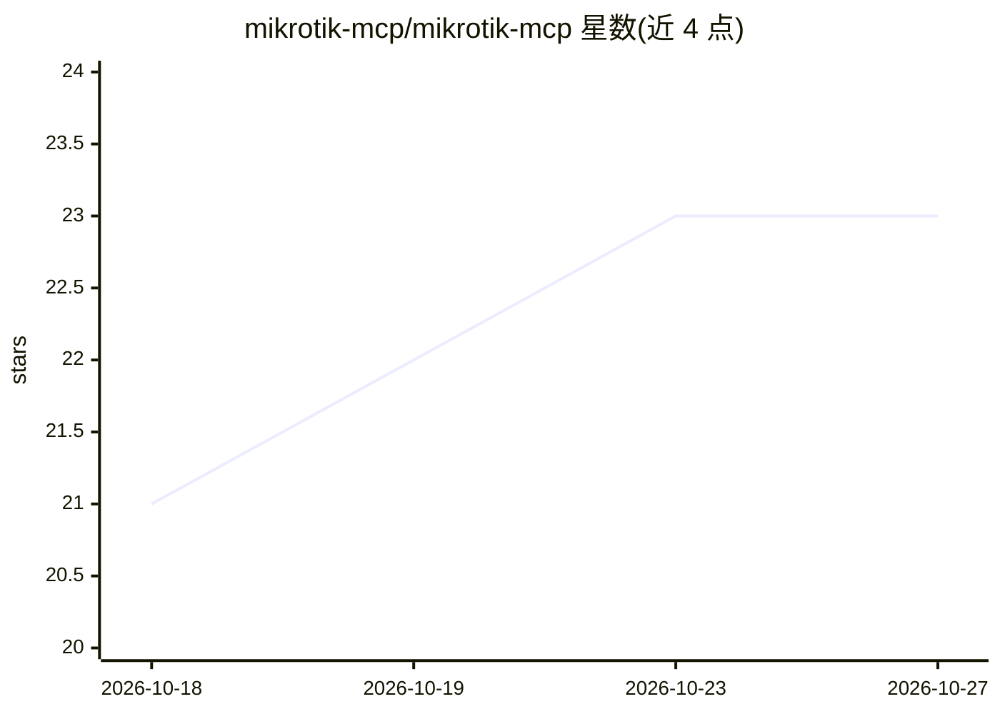

# mikrotik-mcp/mikrotik-mcp

⭐ 23 · TypeScript · MIT · 推送 2026-10-24 · [GitHub](https://github.com/mikrotik-mcp/mikrotik-mcp) · [官网](https://mikrotik-mcp.usestrict.dev) · 个人维护

**把 MikroTik 路由器变成 AI 可调用的 924 个 MCP 工具**

基于 Bun 的 MCP 服务器，通过 SSH 连接一台或多台 MikroTik RouterOS，将防火墙、路由、DHCP/DNS、无线、QoS 及完整 VPN 套件（WireGuard/IPsec/L2TP/OpenVPN 等）暴露为 924 个带风险标注（读/写/破坏性）的工具，供 Claude Desktop、Cursor 等 MCP 客户端以自然语言调用。机制包括事务性 Safe Mode（会话断开自动回滚）、命令注入防护、连接池、SSH 跳板、攻击检测、离线模拟器与本地观测仪表盘。路由器端无需安装任何软件。

## 筛选速览

| 维度 | 判定 | 备注 |
|---|---|---|
| AI 角色 | `ai-ecosystem` | LLM/agent 周边工具 |
| 许可风险 | `permissive` | MIT |
| 部署形态 | `self-host` | docker 或自建部署 |
| 模型依赖 | — | README 未给出锁定关系 |
| 硬件要求 | — | 无带数字的原话,不猜 |
| 安装摩擦 | `low` | 无编译、无系统依赖或容器化 |
| 成熟度 | — | 结构信号不足 |

## 能力要点

- 924 个覆盖 RouterOS 各范围的 MCP 工具，按读/写/破坏性标注风险
- 事务性 Safe Mode：变更暂存内存，会话断开自动回滚
- SSH 直连 + 跳板 + 连接池，无需在路由器上装代理
- 攻击检测、离线防火墙模拟器、explain_device 配置解读与实时观测仪表盘

## 适用场景

- 用自然语言查看和修改路由器防火墙、路由与 DHCP 配置
- 让 AI 指导建立 WireGuard 或 IKEv2 站点到站点 VPN
- 排查 VLAN 不通、端口饱和等网络问题
- 审计路由器配置并在无人值守计划任务中跟踪变更

## 场景标签

 · 领域:网络运维/设备管理

## 证据(README 行号)

> L11: `@usex/mikrotik-mcp` turns **MikroTik RouterOS** into **924 Model Context Protocol
> L12: tools** any MCP client (Claude Desktop, Claude Code, Cursor, …) can call to read and
> L14: agent, no package to install on RouterOS — runs on **Bun**, and

## 星数曲线

2026-10-18 21 → 2026-10-27 23（+2）

---
*卡片 v1 · prompt 1.4 · 生成 2026-10-27 · 置信度 mid · 依据 README sha `45da101faa74` · [字段定义](../../DATASET.md)*
