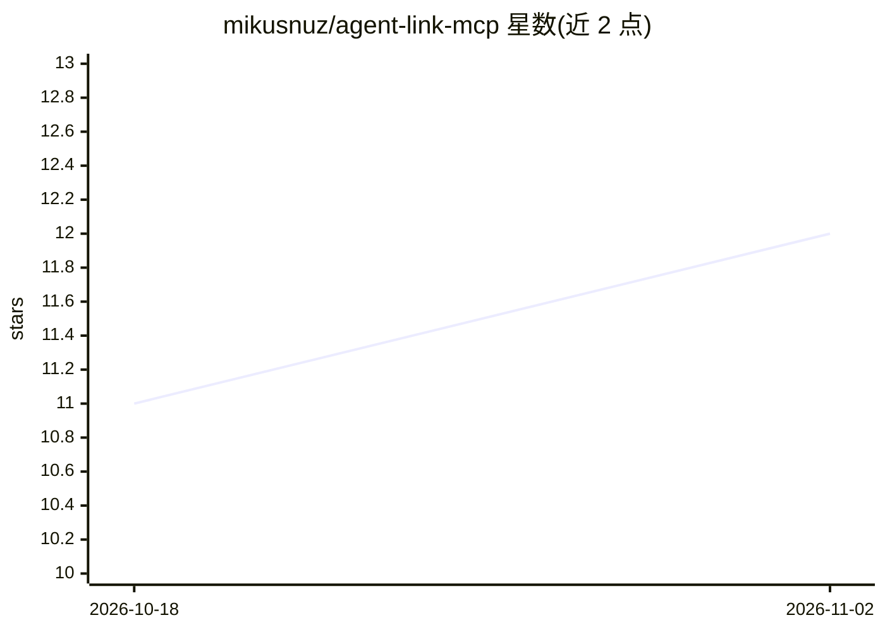

# mikusnuz/agent-link-mcp

⭐ 12 · JavaScript · MIT · 推送 2026-10-19 · [GitHub](https://github.com/mikusnuz/agent-link-mcp) · 个人维护 · 中文 README

**MCP 服务器：让任一 agent CLI 生成并与其他 agent 双向协作**

面向 MCP 兼容 AI 编码 agent 的 MCP 服务器：宿主 agent 可通过 spawn_agent/spawn_agents/reply/kill_agent 等工具，将 Claude Code、Codex、Gemini CLI、Aider 等作为 CLI 子进程生成，派发任务并接收结果；被生成 agent 可用 [QUESTION]/[RESULT] 格式向宿主回问，宿主用 reply 继续对话。支持并行多 agent、模型与思考深度参数、超时与重试。会话保存在内存中，服务器重启后不保留；需 Node.js 20+，通过 npx 安装，仅宿主一侧安装即可，被生成 agent 需自行安装并认证各自 CLI。

## 筛选速览

| 维度 | 判定 | 备注 |
|---|---|---|
| AI 角色 | `ai-ecosystem` | LLM/agent 周边工具 |
| 许可风险 | `permissive` | MIT |
| 部署形态 | `library` | 以包/库形式分发 |
| 模型依赖 | — | README 未给出锁定关系 |
| 硬件要求 | — | 无带数字的原话,不猜 |
| 安装摩擦 | `low` | 无编译、无系统依赖或容器化 |
| 成熟度 | — | 结构信号不足 |

## 能力要点

- 5 个 MCP 工具：spawn_agent/spawn_agents/reply/kill_agent/list_agents（另有 get_status）
- 内置 Claude Code、Codex、Gemini CLI、Aider 四种 profile，可经 config.json 添加自定义 CLI
- 双向问答协议（[QUESTION]/[RESULT]），宿主可回复继续对话
- 支持 model、thinking 推理深度、timeoutMs 超时、retry/escalate 自动重试参数

## 适用场景

- 主 agent 卡在 bug 上时向另一模型求助获取第二意见
- 让不同模型分工完成规划、执行、调研等多 agent 流水线
- 合并前让另一模型对代码改动做交叉审查
- 并行生成多个 agent 处理独立子任务

## 场景标签

`多智能体` `Agent 框架` · 领域:Agent 开发

## 证据(README 行号)

> L8: MCP server for bidirectional AI agent collaboration. Spawn and communicate with any AI coding agent CLI — Claude Cod
> L68: AI coding agents get stuck sometimes. Instead of waiting for you, they can ask another agent for help. **agent-link
> L70: - **One-side install** — only the host agent needs this MCP server. Spawned agents are just CLI subprocesses.

## 星数曲线

2026-10-18 11 → 2026-11-02 12（+1）

---
*卡片 v1 · prompt 1.4 · 生成 2026-11-02 · 置信度 mid · 依据 README sha `13ca738a1a9a` · [字段定义](../../DATASET.md)*
